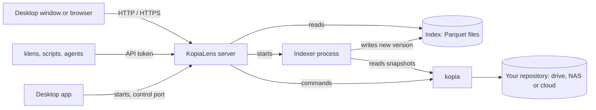

# KopiaLens architecture

How KopiaLens is built: its parts, how it runs, how it uses kopia, how its index works and where it keeps data. Security details are in [SECURITY.md](SECURITY.md), and the user documentation is in [docs](docs/README.md).

## Components

| Part | What it does | Built with |
|---|---|---|
| Server | Runs kopia, reads the index, serves the web interface and the API | Python, FastAPI, Uvicorn, compiled with Nuitka |
| kopia | The backup engine. Each release ships the kopia version it is tested with | [Kopia](https://github.com/kopia/kopia) (Go) |
| Indexer | Reads snapshots into the index, in its own process | Python, DuckDB, PyArrow |
| Web interface | Every screen, in the desktop window or any browser | Alpine.js, Tailwind CSS, Tabulator |
| Desktop app | The window and tray icon. Starts, watches and stops the server | Tauri 2 (Rust), the system's web view |
| Disk scanner | Lists folders and their sizes on your disks for the Excluded view. On Windows, KopiaLens can ask Everything instead | Rust |
| `klens` | Command line for scripts and AI agents, over the API | Python |

## How it runs

- **Desktop app:** the Tauri shell starts the server and talks to it on a small local control port (`7124` by default). Quitting the app stops the server.
- **Docker and Home Assistant:** the same server, without the shell. You open it in a browser.
- **Indexing runs in a separate process** that exits when it finishes, so its memory goes back to the system after each run. Repositories are indexed one at a time, and a run that is in progress continues if the app restarts.
- **One copy per data folder.** An installed copy and a portable copy can run side by side, each with its own data.
- **Ports:** the web interface uses `7123` by default. If a port is taken, KopiaLens moves to the next free one and remembers it.

## How KopiaLens uses kopia

KopiaLens never reads or writes repository files itself. Everything goes through the bundled kopia program, so the repository stays in Kopia's own format and every Kopia tool can still open it.

- **Reading:** the read path accepts only kopia's read commands; anything else is refused. These are `repository status`, `snapshot list`, `ls`, `list`, `show`, `diff`, `content list`, `content show`, `content stats`, `blob stats`, `policy list`, `policy show`, `policy export`, `manifest list`, `manifest show`, `maintenance info` and `cache info`.
- **Changing things:** `snapshot create`, `snapshot delete`, `snapshot pin`, `policy set`, `policy import`, `maintenance run` and `restore` run only as jobs that you preview and confirm (see [Safety](#safety)).
- **Running backups:** when KopiaLens runs a repository's backups, it starts kopia's own server for that repository, listening on this computer only. Kopia's scheduler, retries and maintenance do the work, as they do inside KopiaUI. Analysis and the guarded changes still use the command line.
- **Secrets:** repository passwords and storage credentials are passed to kopia through its environment, never on a command line, and are never written to KopiaLens's own files. Kopia keeps the repository password where it always does, in its connection file or your system's keychain.

## The index

Kopia stores backups as encrypted, deduplicated pieces, and a snapshot is a tree of which pieces make up each file. That's ideal for backing up and restoring, but slow for questions such as "which snapshots hold this file?" or "what would deleting this folder free?". KopiaLens reads each repository once and keeps the answers in an index.

- **What it holds:** every file and folder in every snapshot, with sizes, dates and the pieces each version uses, plus the stored size of each piece. Never file contents.
- **Storage:** one set of Parquet files per repository, read by DuckDB in the server's memory. There is no database server and no database file.
- **Versions:** each index run writes a complete new set of files beside the current one, then switches to it in one step. Only the indexer writes. Each request reads one version from start to finish, so a switch never mixes old and new data. A failed run leaves the current index in place.
- **Fast later runs:** kopia stores an unchanged folder once, so the indexer skips every folder it has already read and reads only what changed.
- **Size:** it grows with the number of files and versions and number of snapshots, not with repo size.
- **Encryption:** the index can be encrypted on disk ([SECURITY.md](SECURITY.md#data-kopialens-keeps)).

More: [How indexing works](docs/how-indexing-works.md), [How KopiaLens counts space](docs/space.md).

## Safety

- Indexing only reads. It never changes a repository.
- Every change is a job: KopiaLens shows exactly what it will do, offers kopia's dry run where one exists, asks you to confirm, and runs it in the background.
- A removal deletes exactly the list you previewed, never a fresh search at the last moment.
- Permissions (Read-only, Restores allowed, Non-destructive, Full Access) are enforced by the server for the interface, the API and `klens` alike.
- Every action is written to an append-only audit log.

More: [SECURITY.md](SECURITY.md), [Can KopiaLens damage my backups?](docs/faq.md#can-kopialens-damage-my-backups).

## Network

| Install | Listens on | HTTPS |
|---|---|---|
| Desktop app | This computer only | Off by default |
| Docker, Home Assistant, servers | Your network | On by default, with a certificate KopiaLens makes itself |

- Who may connect is a setting: this window only, this computer, listed addresses, or anyone on the network.
- HTTPS can also use your own certificate, or sit behind a reverse proxy listed as trusted. `KOPIALENS_HTTPS=off` serves plain HTTP.

More: [Remote access and HTTPS](docs/remote-access.md), [Behind a reverse proxy](docs/guide-reverse-proxy.md).

## API and automation

Everything the interface does goes through a JSON API on the same port. Scripts and AI agents use it with API tokens, directly or through `klens`.

More: [API](docs/api.md), [Command line](docs/cli.md), [API tokens](docs/api-tokens.md), [Use KopiaLens with an AI agent](docs/guide-ai-agent.md).

## Where data lives

| Install | Data folder |
|---|---|
| Windows | `%LOCALAPPDATA%\KopiaLens` |
| macOS | `~/Library/Application Support/KopiaLens` |
| Linux | `$XDG_DATA_HOME/kopialens`, or `~/.local/share/kopialens` |
| Portable (Windows zip) | `data` beside the app |
| Docker | `/config` |
| Home Assistant | The add-on's data folder |

A portable copy's own folder comes first, then `KOPIALENS_DATA_DIR` if set, then the per-user folder above. The data folder holds settings, repository connections (names and locations, no passwords), the index, logs, the audit log and automatic backups of the settings files. Your backups stay where kopia keeps them.

## What leaves your computer

- **Daily check-in:** an update check and anonymous usage numbers, never file names, paths or contents. Both can be turned off ([Update checks and usage stats](docs/usage-stats.md)).
- **Pro licence:** an activated licence checks in once a week and keeps working offline ([Licensing](docs/licensing.md)).
- **Your backups:** only to the storage you chose, sent by kopia.

## Updates and releases

- The installed desktop app and the AppImage update themselves. Every update is signed, and the app checks the signature before installing it.
- Every release file on GitHub has a SHA-256 checksum.
- The Windows and macOS apps aren't code-signed, so the system warns on first open.
- Docker images (`amd64`, `arm64`) are on Docker Hub and GitHub's registry; the Home Assistant add-on updates through Home Assistant.
- Each release ships `THIRD-PARTY-NOTICES.txt` with every bundled component and its licence.

## Tech stack

| Area | Used |
|---|---|
| Backup engine | Kopia |
| Server | Python, FastAPI, Uvicorn, Jinja2 |
| Index | Apache Parquet, DuckDB, PyArrow |
| Encryption | `cryptography` (AES-GCM, HKDF), `argon2-cffi` (Argon2id) |
| Interface | Alpine.js, Tailwind CSS, Tabulator, Phosphor icons |
| Desktop app | Tauri 2 (Rust) |
| Disk scanner | Rust |
| Builds | Nuitka (server), NSIS (Windows installer), AppImage, .deb, .rpm, Docker (Debian slim) |
