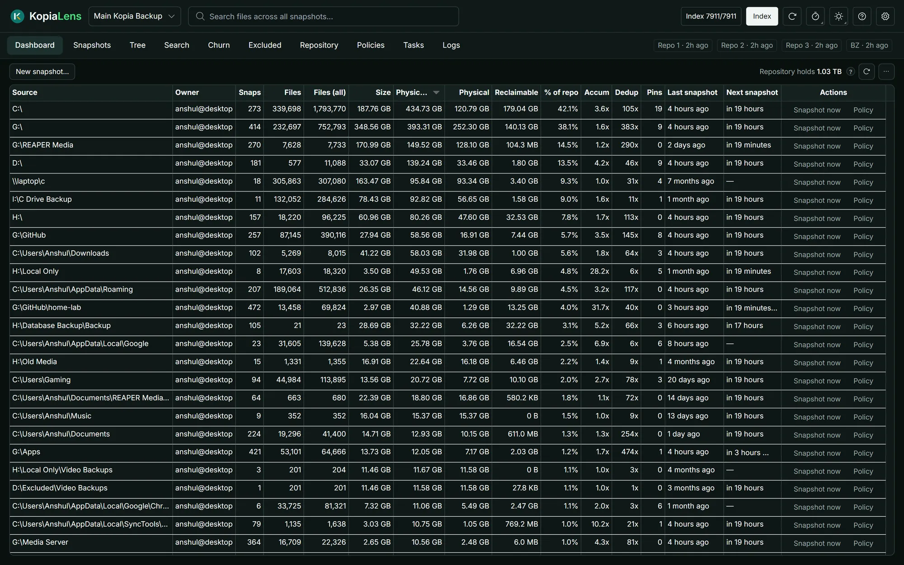

<h1 align="center"> KopiaLens</h1>

<b>A backup app for Kopia, with an analysis engine built in.</b>

Windows · macOS · Linux · Docker · Home Assistant

  <a href="https://kopialens.com/download">Download</a> ·
  <a href="https://kopialens.com/docs">Docs</a> ·
  <a href="https://kopialens.com/pricing">Pricing</a> ·
  <a href="ROADMAP.md">Roadmap</a> ·
  <a href="https://discord.gg/22EU4cqEf6">Discord</a>

<a href="https://kopialens.com/#demo"><b>▶ Watch the video demo</b></a>

## Overview

KopiaLens is a desktop and server app for [Kopia](https://github.com/kopia/kopia) backups. It creates repositories, runs your backups on a schedule, restores files, runs maintenance, and much more. It works on the repositories you already have, and KopiaUI and the kopia CLI can keep working alongside it.

It's designed to answer questions that Kopia can't answer quickly: what each folder really costs after deduplication (the real physical size), which snapshots hold a file, how your backups grow every night, what isn't backed up on your machine, and how much deleting something would actually free.

I built it for my own backups: about 5 TB across two repositories. It found 400+ GB of junk, which I reclaimed, and helped re-organize my backup strategy with its analysis features.

## Features

### Back up

- **Scheduled backups on Kopia's engine:** encrypted, compressed and deduplicated, to any storage Kopia supports (local or network drives, SFTP, S3 and S3-compatible, Backblaze B2, Azure, Google Cloud and more).
- **Restore, download or mount** any file or folder, any version, from any snapshot.
- **Policies and retention**, with an editor that shows what each folder inherits.
- **Maintenance, verify and notifications:** email, Pushover, webhooks and ntfy.
- **Desktop app with a tray**, or headless in Docker and Home Assistant, used from any browser.

### See inside

- **Real sizes** for every folder and source: logical, physical after deduplication, and reclaimable.
- **Search** every file in every snapshot, across all your Kopia repositories.
- **Tree:** browse any snapshot like a disk, largest folders first.
- **Churn:** the files and folders that add new data on every backup.
- **Simulate** a retention policy before you use it.
- **Excluded:** the folders on your disks that no backup covers.
- **Backblaze:** see what Backblaze Personal Backup is really backing up. (Windows-only for now)

### Clean up (Pro)

- **Remove files and folders** from every snapshot that holds them, without deleting the snapshots.
- **Prune versions:** keep the versions of a file you want and remove the rest.
- **Smart excludes and exclude & delete:** stop backing something up and take it out of the past in one step.

### Scripts and AI agents

- **[`klens` command line](https://kopialens.com/docs/cli) and an [HTTP API](https://kopialens.com/docs/api)**, with a token per script or agent.
- **Approvals:** an agent can plan a removal, and nothing is deleted until you approve it in the app.

## Install

| Platform | Get it |
|---|---|
| Windows 10 and 11 | Installer or portable zip |
| macOS (Apple silicon) | App (.dmg) |
| Linux (x64, arm64) | AppImage, .deb, .rpm |
| Docker (amd64, arm64) | `anshulj99/kopialens` or `ghcr.io/anshulj999/kopialens`: [compose example](compose.example.yml), [guide](https://kopialens.com/docs/docker) |
| Home Assistant | [Add-on repository](https://github.com/AnshulJ999/homeassistant-addons) |

All files are on the [releases page](../../releases/latest), with checksums. Install steps for each: [kopialens.com/download](https://kopialens.com/download). Every download includes kopia.

The Windows and macOS apps aren't code-signed, so Windows shows a SmartScreen warning and macOS blocks the first open. The [download page](https://kopialens.com/download) shows how to get past both.

## Getting started

1. **Install** it from the [download page](https://kopialens.com/download) or from GitHub Releases.
2. **Connect your repository.** KopiaLens finds the ones KopiaUI and the kopia command line already use, or you can connect any other or create a new one.
3. **Build the index.** The first run reads the whole repository once; after that it keeps up by itself.

The [first-time setup guide](https://kopialens.com/docs/getting-started) walks through each step.

Coming from KopiaUI or BlinkDisk? [KopiaLens alongside KopiaUI](https://kopialens.com/docs/kopiaui) and [Using KopiaLens with BlinkDisk](https://kopialens.com/docs/blinkdisk) cover sharing a repository and moving your schedules over.

Using another backup app or still deciding? [See how KopiaLens compares](https://kopialens.com/compare).

## Free and Pro

The whole backup app is free: backups, restore, search, and every analysis view, with no time limit and no account. Pro enables the actions that remove junk from inside your old backups. Most Pro actions have cleanup previews, and all Pro actions can be tested on sample data. [See pricing](https://kopialens.com/pricing).

## How KopiaLens handles your backups

- **Your backups are standard Kopia backups.** KopiaUI and the kopia command line can always open, restore and keep running them. Your backups don't depend on KopiaLens.
- **Reading is the default.** Nothing in a repository changes unless you start an action, and every action shows exactly what it will do first.
- **You choose how much it may change.** Permissions range from read-only to full access, for the whole app or per repository.
- **Everything is on the record.** The audit log lists every action, and whether a person, a token or an agent started it.
- **Your file names stay on your computer.** No file names, paths or contents are ever sent anywhere. A daily update check sends anonymous usage numbers, and you can turn off either one ([what is sent](https://kopialens.com/docs/usage-stats)).

More detail: [How KopiaLens works](ARCHITECTURE.md) and [Security](SECURITY.md).

## Tested on

I test KopiaLens on my own backups every day. They're two very different shapes:

| | Main repository | Big repository |
|---|---|---|
| What's in it | A whole PC: system, apps, documents | Large data and media |
| Shape | Many small files, very frequent snapshots | Fewer, much bigger files |
| Stored data | About 1 TB | About 4 TB |
| Snapshots | About 7,500 | About 3,500 |
| Paths | About 5.4 million | About 3.2 million |
| File versions | About 19.5 million | About 18.5 million |

Both are on local disks, so I haven't measured speed at this size on cloud storage, and I haven't tried repositories much bigger than these. If you do, I'd love to hear how it goes!

More on memory and disk use: [Hardware and memory](https://kopialens.com/docs/hardware).

## AI Disclosure

I built KopiaLens with a lot of AI help, mainly Claude Opus, and more than 500 hours of my own. I designed it, planned it and reviewed the work, and I've used it for my own backups every day since June 2026. If something's wrong, that's on me, so please open an issue and I'll fix it.

## Feedback and Bugs

- Found a bug or want a feature? [Open an issue](../../issues/new/choose). 
- Questions and setup help: [the docs](https://kopialens.com/docs), [Discord](https://discord.gg/22EU4cqEf6) or support@kopialens.com.
- Found a security problem? Please report it privately: [SECURITY.md](SECURITY.md).

## Thanks to Kopia

❤️ Thank you to the Kopia team and contributors. KopiaLens wouldn't exist without Kopia. It's one of the best backup engines out there: fast, secure and dependable. 

KopiaLens is an independent project, not affiliated with or endorsed by the Kopia project.

## Support the project

KopiaLens is built by one independent developer. If you'd like to back its development, use the Sponsor button at the top of this page, or see [kopialens.com/sponsor](https://kopialens.com/sponsor).

---

## Credits

KopiaLens is built on the work of these open-source projects:

- [Kopia](https://github.com/kopia/kopia): the backup engine underneath everything
- [DuckDB](https://github.com/duckdb/duckdb) and [Apache Arrow / Parquet](https://github.com/apache/arrow): the index
- [FastAPI](https://github.com/fastapi/fastapi) and [Uvicorn](https://github.com/encode/uvicorn): the server
- [Tauri](https://github.com/tauri-apps/tauri): the desktop app
- [Alpine.js](https://github.com/alpinejs/alpine), [Tailwind CSS](https://github.com/tailwindlabs/tailwindcss) and [Tabulator](https://github.com/olifolkerd/tabulator): the interface
- [Phosphor Icons](https://github.com/phosphor-icons/core): icons
- [cryptography](https://github.com/pyca/cryptography) and [argon2-cffi](https://github.com/hynek/argon2-cffi): encryption
- [Nuitka](https://github.com/Nuitka/Nuitka): compiling the server
- [Everything](https://www.voidtools.com) by voidtools: fast disk lookups on Windows

The full list of components and their licences ships with every release (`THIRD-PARTY-NOTICES.txt`) and is in the app under **Settings → About → Third-party notices**.