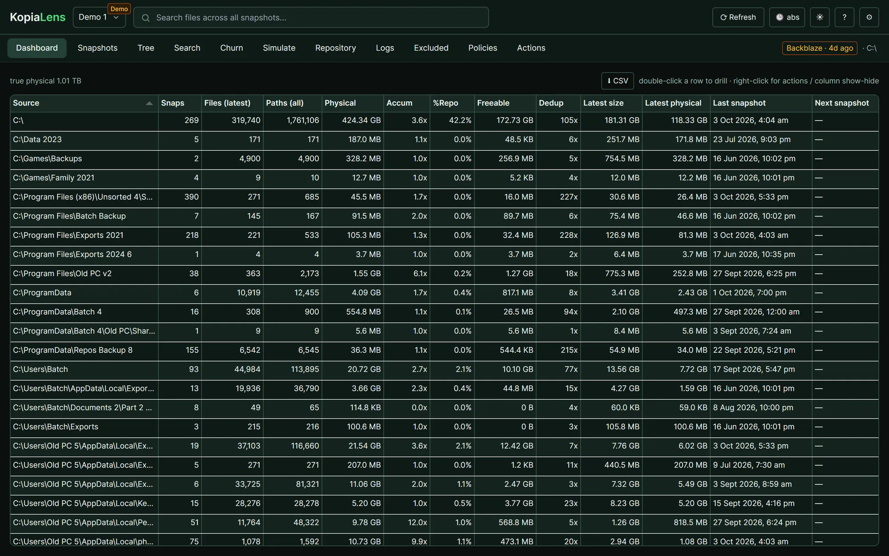

<h1 align="center"> KopiaLens</h1>

<b>Find what's bloating your Kopia backups. Get the space back.</b>

  <a href="https://kopialens.com/download">Download</a> ·
  <a href="https://kopialens.com/docs">Docs</a> ·
  <a href="https://kopialens.com/pricing">Pricing</a> ·
  <a href="https://discord.gg/22EU4cqEf6">Discord</a>

KopiaLens shows the real size of everything in your [Kopia](https://kopia.io) repository, finds the files you never meant to keep, and removes them from every snapshot that holds them, with a dry run first.

It works on the repository you already have, beside KopiaUI and the kopia command line, or on its own: it includes kopia and can run your backups too.

## What it does

- See where the space goes: every backed-up folder with its real cost after deduplication
- Find any file in any snapshot, with every version of it
- Rank snapshots by how much deleting them would free
- Catch the folders that rewrite themselves on every backup
- Browse any snapshot like a disk
- Try a retention policy before you use it
- Write exclusions that do what you meant, and check what isn't backed up
- Run backups on schedule, restore, mount and edit policies
- Remove files and folders from existing snapshots (Pro)

## Download

| Platform | Get it |
|---|---|
| Windows 10 and 11 | Installer or portable zip |
| macOS (Apple silicon) | App (.dmg) |
| Linux (x64, arm64) | AppImage, .deb, .rpm |
| Docker (amd64, arm64) | `ghcr.io/anshulj999/kopialens` |
| Home Assistant | Add-on repository |

All files are on the [releases page](../../releases/latest), with checksums. Install steps for each: [kopialens.com/download](https://kopialens.com/download).

KopiaLens needs an ordinary desktop, laptop or home server; how much memory and disk it uses: [Hardware and memory](https://kopialens.com/docs/hardware).

## Free and Pro

Everything KopiaLens shows you is free, with no time limit. Pro adds the actions that remove data from inside your backups. [See pricing](https://kopialens.com/pricing).

## Your backups stay yours

- Nothing in your repository changes unless you start an action, and every action shows exactly what it will do first.
- No file names, paths or backup contents leave your computer. A daily update check sends anonymous usage numbers, and both can be turned off ([what is sent](https://kopialens.com/docs/usage-stats)).

## Bugs, ideas and questions

- Found a bug or want a feature? [Open an issue](../../issues/new/choose).
- Questions and setup help: [the docs](https://kopialens.com/docs), [Discord](https://discord.gg/22EU4cqEf6) or support@kopialens.com.

This repository holds KopiaLens's releases and issue tracker.

## Thanks to Kopia

❤️ Thank you to the Kopia team and contributors. KopiaLens wouldn't exist without Kopia. It's one of the best backup engines out there: fast, secure and dependable, and I'm grateful to be able to build on it. KopiaLens is an independent project, not affiliated with or endorsed by the Kopia project.

## Support the project

KopiaLens is built by one independent developer. If you'd like to back its development, use the Sponsor button at the top of this page, or see [kopialens.com/sponsor](https://kopialens.com/sponsor).

---

Third-party licences: Settings → About → Third-party notices in the app.
