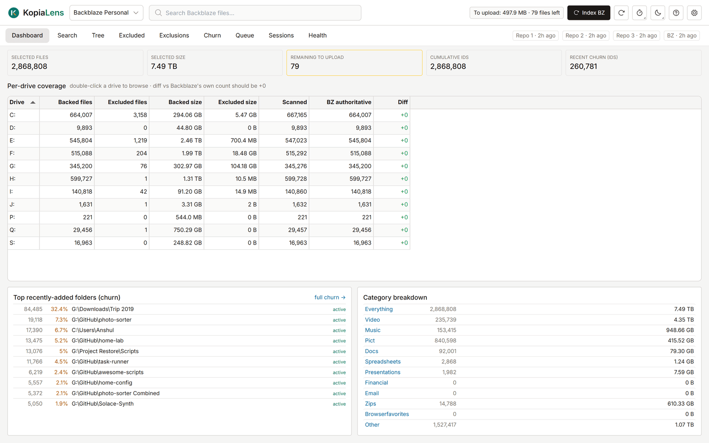

# Backblaze

KopiaLens can show what Backblaze Personal Backup backs up on the same computer, next to your kopia backups. It reads the Backblaze client's own file lists and never changes anything in Backblaze.

## Add Backblaze

The Backblaze view works on Windows, with the Backblaze Personal Backup client installed.

1. Open **Settings → Backblaze**.
2. Select **Add Backblaze**. KopiaLens finds the client's data folder on its own.

Backblaze then appears in the repository list at the top of the window. Select it there to open its tabs. If KopiaLens doesn't find the client, the section says so. To point it at the folder by hand, enter it in **Backblaze data folder**.

KopiaLens only reads the Backblaze folder. It never writes there, and it can't delete, restore or change anything in Backblaze.

## The tabs

| Tab | What it shows |
|---|---|
| **Dashboard** | How many files and how much data Backblaze has selected, what is left to upload, coverage per drive, recently added folders and a breakdown by file type |
| **Search** | Every path Backblaze knows, backed up or excluded. Filter by drive, status and extension. **By folder** groups the results |
| **Tree** | Backblaze's backup by folder, with each folder's status: backed up, excluded or mixed |
| **Excluded** | What on disk Backblaze doesn't back up, worked out from Backblaze's own scan and its exclusion rules. **Also in Kopia** shows folders that a kopia repository backs up too |
| **Exclusions** | Backblaze's exclusion rules: your folder rules, excluded extensions, and its built-in rules. Shows what each rule keeps out, and rules that match nothing on disk now |
| **Churn** | Recently added files by folder, to spot folders that keep changing |
| **Queue** | Files waiting to be uploaded, and what was backed up in the last 30 days |
| **Sessions** | Recent backup sessions and a daily upload history |
| **Health** | Signs that Backblaze's file lists are damaged, such as a drive suddenly showing no backed-up files |

Backblaze scans the disk about once or twice a day, so most numbers change about once a day.

## Naming-gap hunter

Backblaze's rules match exact paths, so the same kind of data can be excluded in one place and backed up in another. In **Exclusions**, type part of a folder name and select **Find gaps**. KopiaLens lists every folder with that name and whether Backblaze backs it up.

## Updates

KopiaLens reads Backblaze's lists again when they change. It waits a while after Backblaze's own scan before it does, so it doesn't read the lists halfway through a scan. These settings are in **Settings → Backblaze**:

- **Backblaze updates**: **When Backblaze's file lists change**, or **Off, only when I start it**.
- **Reindex minimum gap**: how long to wait after Backblaze's scan changes.
- **History retention**: how many days of folder history to keep for the trends.

To read the lists now, select **Index BZ** in the header.

## Related

- [Excluded](excluded.md)
- [Settings](settings.md#backblaze)
