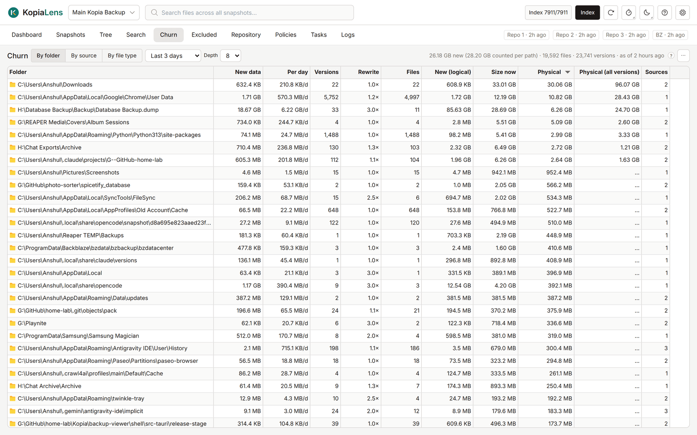

# Churn

Churn shows what keeps adding new data to your backups. Files that are rewritten again and again, such as caches, databases and logs, can cost far more space than their size suggests. They are often worth excluding.

## Choose a view

- **By source**: which sources added the most new data.
- **By folder**: which folders added it, grouped to the **Depth** you pick (how many folder levels deep to group by, 4 by default).
- **By file type**: which extensions added it.

The time window is set in the list next to the views, from **Last 24 hours** to **Last year**. The default is 30 days. All three views come from one calculation, so their numbers always agree.

The line above the table gives the totals for the window: the new data with shared data counted once, the files and the versions.

## What it shows

| Column | What it means |
|---|---|
| **New data** | Data first stored during the window. Data that two paths share counts for both |
| **Per day** | New data divided by the days in the window, so windows of different lengths compare fairly |
| **Versions** | How many file versions were written. Many versions of few files means the same files are rewritten |
| **Rewrite** | Versions divided by files: how often the average file was rewritten. A heavily rewritten row shows in a warning colour |
| **Files** | Files that added new data |
| **New (logical)** | The same new versions at their size on disk, before compression and deduplication |
| **Size now** | The size of everything here in the latest snapshot |
| **Physical** | The space the newest version takes in the repository |
| **Physical (all versions)** | The space every kept version takes. In the folder view, worked out for the rows on screen as you scroll |
| **Mostly from** | By source: the folder that added the most |
| **Sources** | By folder: how many sources added churn in this folder |

**inside** next to a source means another source also covers this folder. Its data is snapshotted twice and counted in both rows.

Several sources in one folder usually means subfolders with their own policies, not duplicated data. Open the folder to see which sources cover it.

## What you can do

Right-click a row:

- By source: **Details of its top folder**, **Show snapshots**, **Show in Tree**, **Search this source**, **Simulate this source**, **Copy source**.
- By folder: **Details** ([Folder panel](folder-panel.md)), **Show in Search**, **Exclude & delete…**, **Delete folder from backups…**, **Copy path**.
- By file type: **Search this extension**.

The numbers are saved and shown again next time. To work them out again now, select **Recompute now** in the **…** menu. **Export CSV** is in the same menu.

## Related

- [Find files that change every day](guide-find-churn.md)
- [Exclude](exclude.md)
- [How KopiaLens counts space](space.md)
