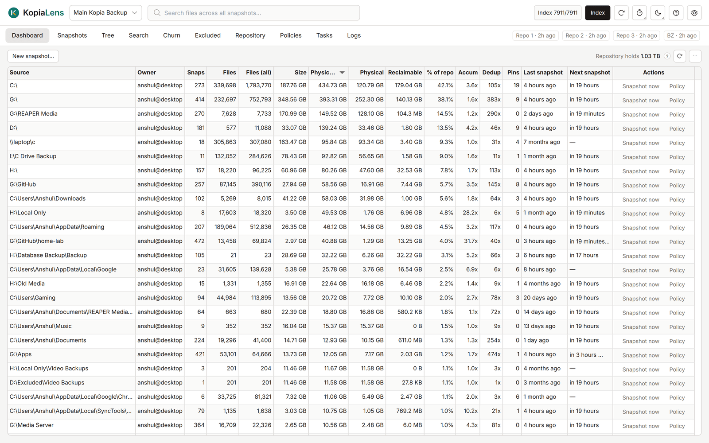

# Dashboard

The Dashboard lists every [source](glossary.md#source) in the repository, with what each one holds and what it costs in space. Start here to see where the repository's space goes.

## What it shows

One row per source. Above the table, **Repository holds** shows the space the whole repository takes, with data that several sources share counted once.

| Column | What it means |
|---|---|
| **Source** | The folder kopia backs up |
| **Owner** | The user and computer that back it up, as `user@computer` |
| **Snaps** | How many snapshots of this folder the repository holds |
| **Files** | Files in the latest snapshot |
| **Files (all)** | Every file in any snapshot of this folder |
| **Size** | The latest snapshot's size, as on disk ([logical](glossary.md#logical)) |
| **Physical** | The space the latest snapshot takes in the repository ([physical](glossary.md#physical)) |
| **Physical (all)** | The space every snapshot of this folder takes together ([physical (all)](glossary.md#physical-all)) |
| **Last snapshot** | When the newest snapshot was taken |
| **Next snapshot** | When the schedule takes the next one. **overdue** means the scheduled time has passed and no snapshot was taken |
| **Actions** | **Snapshot now** and **Policy**. While a backup runs, its progress shows here instead |

More columns are hidden at first. To show or hide a column, right-click any column header ([Tables](tables.md)).

| Column | What it means |
|---|---|
| **Accum** | The space all versions take, divided by the space of the latest snapshot ([accum](glossary.md#accum)) |
| **% of repo** | This source's share of the space the repository takes |
| **Reclaimable** | The space that deleting every snapshot of this source gives back ([reclaimable](glossary.md#reclaimable)) |
| **Dedup** | The sizes of all snapshots added up, divided by the space they take |
| **Pins** | Snapshots with a [pin](glossary.md#pin), which retention never removes |

The space columns come from the last [index run](glossary.md#index-run). [How KopiaLens counts space](space.md) explains why they differ.

## What you can do

- **See a source's snapshots:** double-click its row. The [Snapshots](snapshots.md) tab opens on that source.
- **Take a snapshot now:** select **Snapshot now** on the row. By default KopiaLens asks first and lets you add a description. To start straight away, turn off **Ask before Snapshot now** in **Settings → General**.
- **Open the source's policy:** select **Policy** on the row. The [policy editor](policies.md#edit-a-policy-from-other-screens) opens in a popup.
- **More actions:** right-click a row for **Show in Tree**, **Simulate this source**, **Copy source** and **Delete this source…**.
- **Back up a new folder:** select **New snapshot…** above the table ([New snapshot](new-snapshot.md)).
- **Choose who runs backups:** select the **Backups:** button. It names who runs this repository's backups now ([Backups](backups.md#who-runs-backups)).
- **Read new snapshots:** select the refresh button next to **Repository holds**. KopiaLens reads kopia's snapshot list again and recomputes the numbers. It doesn't rebuild the index.
- **Export:** the **…** menu has **Export CSV** and **Show command** (the kopia command behind the table).
- **Many sources:** the **…** menu has **Rows per page** and **Table layout…** ([Tables](tables.md)).

## Whose backups to show

When the repository holds backups from more than one computer, a filter appears above the table: **All computers**, **This computer**, or one `user@computer`. The choice is kept per repository and also applies to the Snapshots tab.

## Related

- [How KopiaLens counts space](space.md)
- [Backups](backups.md)
- [Deleting snapshots and sources](delete-snapshots.md)
