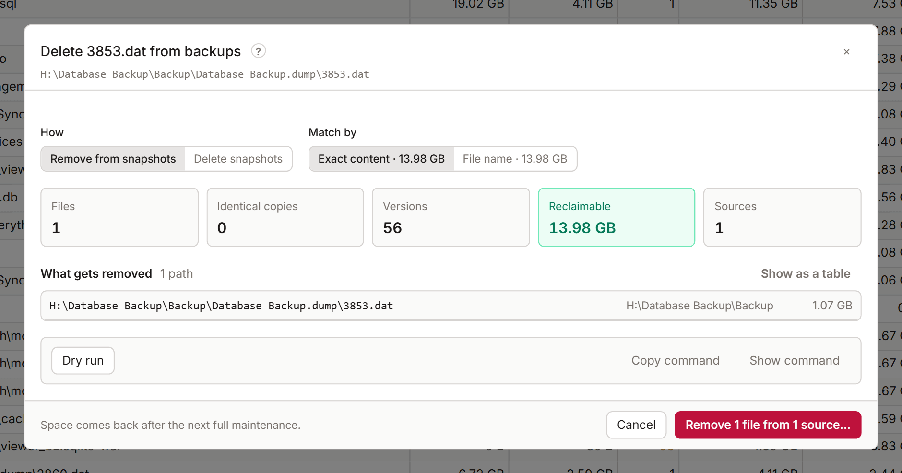

# Delete from backups

KopiaLens can remove files and folders from snapshots you already have, to free the space they take. This page explains the delete panel, the folder plan and how a delete runs. Removing files from snapshots is a [Pro](licensing.md) action. Every preview and figure is free.

**Before you start:** a delete removes data from your backups for good. You can't restore a removed file from any snapshot afterwards. Every delete shows exactly what goes, runs a dry run first, and asks you to confirm.

## Remove or delete snapshots

The delete panel opens from **Delete from backups…** on a file. Under **How**, choose:

- **Remove from snapshots**: the snapshots stay, and only these files are taken out of them.
- **Delete snapshots**: whole snapshots go, with every other file in them. Pinned snapshots and snapshots kept by retention are counted separately, so you see what you'd lose.

For **Remove from snapshots**, set what to match and where:

| Option | Choices |
|---|---|
| **Match by** | **Exact content**: the same bytes, at any path. **File name**: any file with this name |
| **In** | **These sources**, or **Every source** that holds these files or the same content |

**Include identical copies** (with **Delete snapshots**) also deletes the snapshots that hold identical copies at other paths.

Matching by file name removes every file with that name, including files outside your selection, and every version of them. Kopia matches names case-sensitively: `Config.json` isn't `config.json`. Matching by exact content removes identical copies at other paths too. The panel lists these extra files before you go on.

## What the panel shows

- **Sources**: which sources hold the file, and which hold the same content at another path.
- **Files**: the files that go, including other same-named files and identical copies.
- **Versions** and **Reclaimable**: how many versions go, and the space that comes back.
- **What gets removed**: the list of paths. **Show all** lists every one, and **Show as a table** shows them in a table.
- **Identical files with other names**: copies the delete doesn't touch, which keep their data stored.

## Delete a folder

**Delete folder from backups…** (in the Tree, Search, Churn or the folder panel) opens the folder plan. It removes everything under the folder, or everything a search matches with **Delete all … matching…** in Search.

| Option | Choices |
|---|---|
| **Match by** | **Exact content** or **File name** |
| **Versions** | **Every version**, or **Newest only**. A delete by file name always removes every version |
| **In** | **These sources** or **Every source**. Every source can be slow |
| **Delete** | **Everything**, or only the **Largest** files, for example the largest 100. The biggest few hundred files usually hold most of the space |

**What gets removed** lists the plan by **Biggest files**, **By folder** or **By file type**. **Download list** saves every file as a CSV file. **Work out reclaimable space** works out the exact figure for the whole plan.

A plan holds at most 200000 files. A bigger match is planned for its biggest files first. Change the limit in **Settings → Advanced → Most files in one delete plan**.

## Run the delete

1. Select **Dry run**. Kopia runs the same commands without changing anything and lists what it would remove. When it's done, the panel shows **dry run checked**.
2. Check the result. **Show command** shows the kopia commands, and **Copy command** copies them. In the folder plan, **Save script** saves them as a script that logs kopia's output.
3. Select **Next: review**.
4. Check the summary and confirm.

The delete runs as a job in the [job panel](job-panel.md). KopiaLens deletes exactly the files the preview listed. If the index changed since the preview, the job says so. If the preview is too old, the panel previews again before it runs.

## When the space comes back

A delete removes the files from the snapshots straight away. The space comes back after kopia's next full maintenance ([When the space comes back](space.md#when-the-space-comes-back)). The job panel offers **Run maintenance…** when it's done.

KopiaLens updates its index 5 minutes after the last delete, so the Tree and Search stop listing the removed files.

## Exclude and delete

**Exclude & delete…** does two things in order: it adds an exclusion rule, so future snapshots leave the files out, then it removes them from the old snapshots. Without the rule, the next snapshot backs the files up again.

1. The first step is the [exclude dialog](exclude.md).
2. Select **Next: delete**. The panel lists the files to delete and any source that still backs them up.
3. Select **Dry run the delete**, then **Exclude and delete…**.

KopiaLens backs up the policies before it adds each rule. If a rule can't be added, the delete doesn't run.

## Related

- [Free up space safely](guide-free-space.md)
- [Deleting snapshots and sources](delete-snapshots.md)
- [Prune versions](prune.md)
