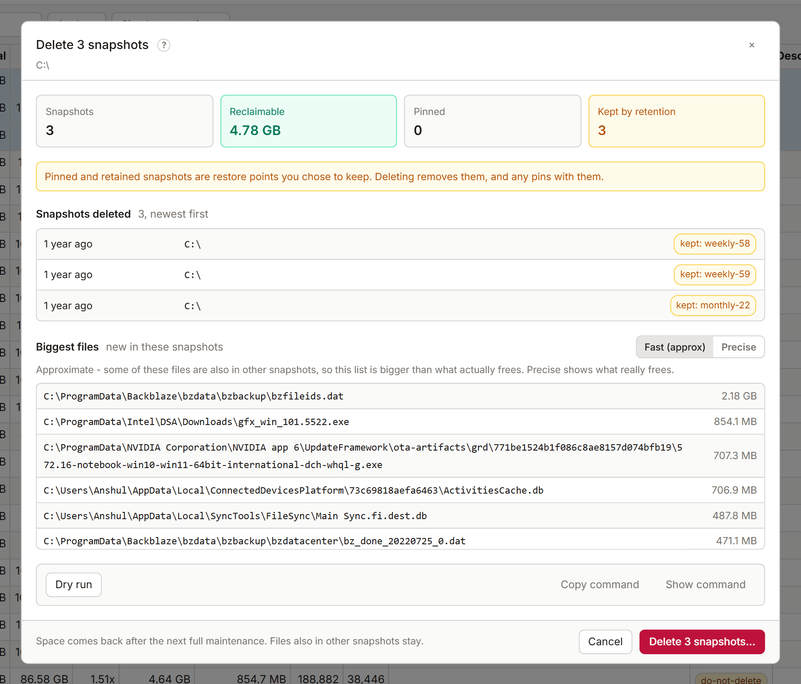

# Deleting snapshots and sources

Deleting a snapshot removes that restore point and every file in it. Deleting a source removes every snapshot of a folder. Both free space only for data that nothing you keep still uses. To take only some files out of your snapshots instead, see [Delete from backups](delete-files.md).

Deleting snapshots and sources needs the **Full Access** permission ([Permissions](settings.md#permissions)). Both are free.

## Delete snapshots

1. In the [Snapshots](snapshots.md) tab, select the snapshots. **Select unretained snapshots** and **Select identical duplicates** in the right-click menu pick common sets.
2. Select **Delete snapshot…** at the top right.
3. Check the panel:
   - **Snapshots**: how many, and the time span they cover.
   - **Reclaimable**: the space the whole set gives back. KopiaLens works out the exact figure for the set, which is often more than the snapshots' own figures added up.
   - **Pinned** and **Kept by retention**: restore points you chose to keep. Deleting removes them, and their pins with them.
   - **Snapshots deleted**: the list, newest first.
   - **Biggest files**: the largest files the delete gives back. **Fast (approx)** lists the files these snapshots added, some of which other snapshots still hold. **Precise** lists only what really frees. The first precise list can take a minute.
4. Select **Dry run**. Kopia checks the delete without changing anything.
5. Select **Delete** and confirm.

When no analysis exists yet, the reclaimable figure adds up each snapshot's own number, and the panel says so. Select **Analyze** in the Snapshots tab for the exact figure.

## Delete a source

Deleting a source deletes every snapshot of that folder. Right-click a source on the [Dashboard](dashboard.md) and select **Delete this source…**.

1. Check the source, how many snapshots it has, and how many are pinned. Pinned snapshots are deleted too.
2. Tick **Also delete this source's policy** to remove the policy as well. Otherwise it stays, and a new snapshot of the folder uses it again.
3. Select **Dry run** to check it first.
4. Select **Delete** and type `delete` to confirm.

**Warning:** this deletes every backup of the folder. It can't be undone.

## After a delete

The delete runs as a job in the [job panel](job-panel.md). The snapshots disappear from the lists when the job ends. The space comes back after the next full maintenance ([When the space comes back](space.md#when-the-space-comes-back)).

Snapshots that no retention rule and no pin keeps don't need deleting by hand: each time kopia takes a snapshot of a source, it applies the source's retention and deletes them.

## Related

- [Snapshots](snapshots.md)
- [Simulate](simulate.md)
- [Maintenance](maintenance.md)
