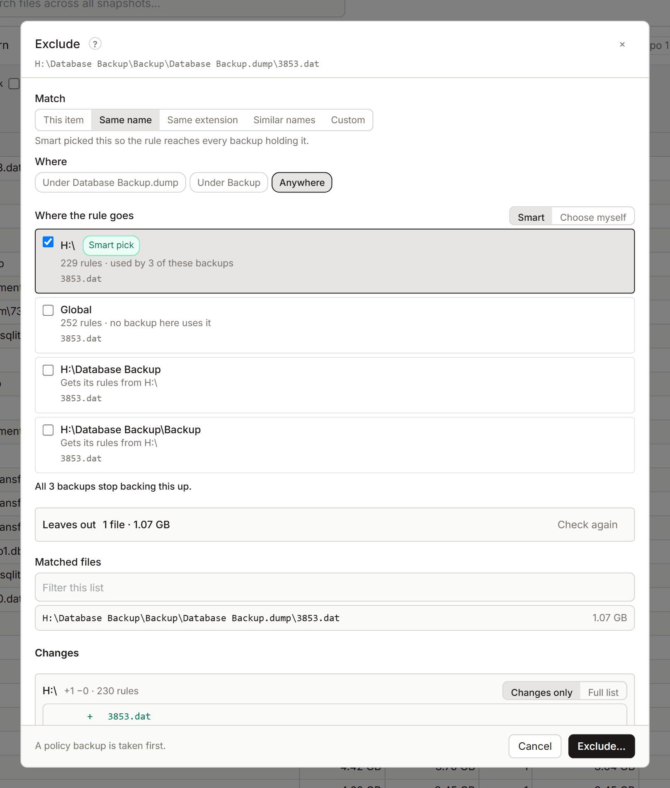

# Exclude

Excluding a file or folder keeps it out of future snapshots. KopiaLens writes the [exclusion rule](glossary.md#exclusion-rule) into the right kopia policy for you and shows what it will leave out before you save. Excluding doesn't touch existing snapshots. To remove the files from those too, use **Exclude & delete…**.

## Open it

Right-click a file or folder in the Tree, Search or the Excluded tab and select **Exclude…**. The file and folder panels have **Exclude…** too, and **Stop backing this up** offers a ready-made rule.

## Choose what the rule matches

| Match | What the rule covers |
|---|---|
| **This item** | Exactly this file or folder |
| **Its folder** | The folder it's in |
| **Same name** | Every file or folder with this name |
| **Same extension** | Every file with this extension |
| **Similar names** | Names that differ only in numbers and dates, for example `log-2026-10-01.txt` and `log-2026-10-02.txt`. Numbers and dates become `*`. Edit the pattern if you like |
| **Custom** | Your own kopia ignore pattern, for example `/Users/*/Cache/**`. It's written as typed. A leading `/` starts from each backup's own folder |

**Where** sets how far it reaches: **In its folder only**, **Under its folder**, or **Anywhere**.

Excluding one file or folder is free. **Same name**, **Same extension** and **Similar names** are [Pro](licensing.md) rules.

**Leaves out** shows what the rule keeps out of the backups, from the index: how many files and how much data. **Matched files** lists them. **Open in Search** shows them in Search.

## Where the rule goes

Kopia reads exclusion rules from policies, and a policy with its own rules stops using the rules it would inherit ([How policies apply](policies.md#how-policies-apply)). So where a rule goes matters.

- **Smart** (the default) puts the rule in the policies the sources already get their rules from, so nothing they inherit is lost. Smart may also switch **This item** to **Same name**, when that is what reaches every backup holding the item.
- **Choose myself** lets you tick the policies.

If you tick a policy that inherits its rules, the dialog offers to copy the inherited rules into it with the new rule. Later changes to the parent's rules then no longer reach it. If you don't copy them, the dialog warns that the files those rules leave out start being backed up again.

**No backup holds this path** means no source backs it up, so there's nothing to exclude.

## Save it

1. Check **Changes**: each policy and the rule it gets.
2. Select **Exclude…**.

KopiaLens backs up the repository's policies before it writes the rule. The next snapshot of each source leaves the files out.

## Exclude and delete

**Exclude & delete…** opens the same dialog. After the rule, select **Next: delete** to remove the files from the existing snapshots too ([Exclude and delete](delete-files.md#exclude-and-delete)).

## Related

- [Policies](policies.md)
- [Exclude a folder and remove it from old snapshots](guide-exclude-and-delete.md)
- [Churn](churn.md)
