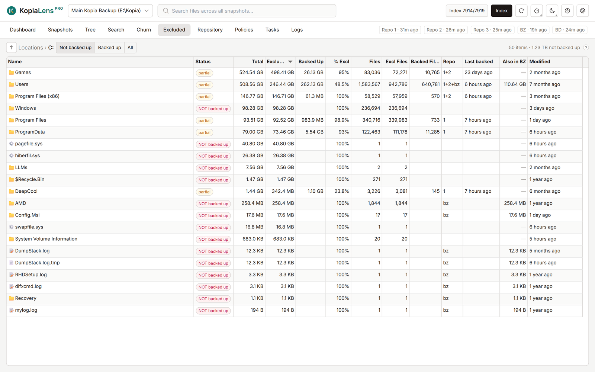

# Excluded

The Excluded tab compares what is on your disks with what your backups hold. It shows the folders and files that no backup covers, so you can find what you forgot to back up.

## What it compares

A file counts as backed up when the latest snapshot of any repository holds it. So a file that only an old snapshot holds counts as not backed up.

- It checks the disks of the computer running KopiaLens. On Windows, that's the local fixed drives. On Linux, macOS and in Docker, it's the mounted folders a user could back up. System folders such as `/proc` and KopiaLens's own data folder are left out.
- It also checks the places you add in **Settings → Disk scanning**, such as a network share of another computer ([Check other places](disk-scanning.md#check-other-places)).
- Every kopia repository counts, unless you turn off **Counts as a backup** for it in **Settings → Repositories**. Turn it off for a test repository, so it doesn't make folders look backed up.
- Backblaze Personal Backup doesn't count, but the **Also in BZ** column shows what it holds of each folder.

To read the disk, KopiaLens uses the **Read the disk with** setting in **Settings → Disk scanning**. On Windows, it uses Everything (a free file index by voidtools), which answers at once. The KopiaLens scanner is off until you choose it there. It counts the folder you open for up to the **Scan time limit** (15 seconds by default), and a subfolder that needs longer shows **Not counted**. Right-click it and select **Count size** to count it to the end ([Disk scanning](disk-scanning.md)).

## Browse

The tab opens on **Locations**, with one row per drive, mounted folder or added place. Double-click a folder to open it, or use the path above the table to go back. **↑** goes up one level.

The buttons at the top filter the list:

- **Not backed up**: folders and files that aren't fully backed up.
- **Backed up**: folders and files that are, fully or in part.
- **All**.

## What it shows

| Column | What it means |
|---|---|
| **Name** | The folder or file |
| **Status** | **backed up**, **NOT backed up**, **partial** (part of the folder is excluded), **new (not yet)**: changed after the latest snapshot, so the next snapshot will hold it, **counting…**: being counted now, **not counted**: select **Count size** to count it, **other disk**: another disk mounted there (Linux and macOS), or **empty**: nothing on disk, shown only under **All** |
| **Total** | Its size on disk |
| **Backed Up**, **Excluded** | How much of it is backed up and how much isn't |
| **% Excl** | The share that isn't backed up |
| **Files**, **Backed Files**, **Excl Files** | The same, counted in files |
| **Last backed** | When a snapshot last held it |
| **Repo** | The repository that holds it |
| **Also in BZ** | How much of it Backblaze holds |
| **Modified** | When it last changed on disk |

A folder counts as backed up when only a small share of it is excluded. The share is set by **Excluded-folder tolerance** in **Settings → Disk scanning**. It cuts noise from folders where only a few small files are left out.

## What you can do

Right-click a row:

- **Open** a folder, or see its **Details**.
- **Back this up…** copies the kopia command that adds the folder to each repository. Run the one for the repository you want. To back it up from KopiaLens instead, use **New snapshot…** on the Dashboard ([New snapshot](new-snapshot.md)).
- **Exclude…** writes an exclusion rule for something you never want backed up ([Exclude](exclude.md)).
- **Policy…** opens the policy that rules this folder in the open repository, in a popup ([Policies](policies.md#edit-a-policy-from-other-screens)).
- **Copy path**.

## Limits

- Another computer's folders are checked only through a place you add, such as its network share ([Check other places](disk-scanning.md#check-other-places)).
- On Windows, network drives and removable drives aren't listed as drives. Add a network share as a place instead.

## Related

- [Check your backups](guide-check-backups.md)
- [Policies](policies.md)
