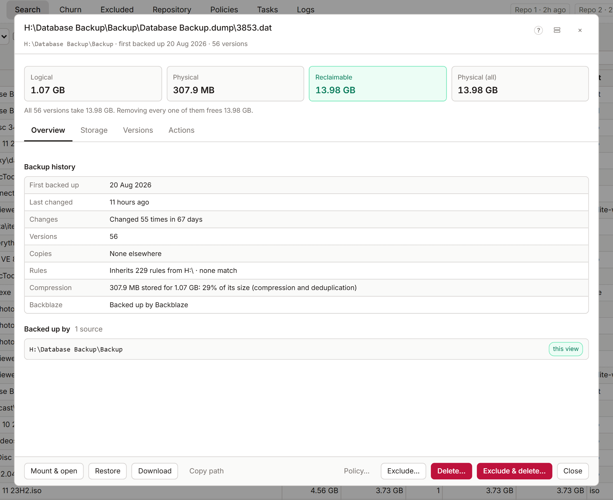

# File panel

The file panel shows everything KopiaLens knows about one file in your backups: its versions, what it costs in space, where else the same data sits, and what deleting it would give back. Open it with **Details** on any file in the Tree or Search.

## The summary

The top of the panel names the file, its path, when it was first backed up, how many versions are stored and whether it's still on disk. Four figures follow:

| Figure | What it means |
|---|---|
| **Logical** | The newest version's size, as on disk |
| **Physical** | The space the newest version takes in the repository |
| **Reclaimable** | The space you get back by removing this file from every source that backs it up. Data it shares with other files stays |
| **Physical (all)** | The space every version takes together |

When identical copies at other paths keep the data stored, the panel says so and gives a second figure: **Removing every copy frees** this much. [How KopiaLens counts space](space.md) explains the difference.

## Where the storage goes

This section breaks the file's stored data down across all its versions:

- **reclaimable**: data only this file uses, which comes back when it goes.
- **Shared with** other files: data this file shares with them. Select a file to open it.
- **Identical copies** at other paths: the same bytes elsewhere in your backups.
- **Shared with data not indexed yet**: data used by snapshots taken since the last index run. The next index run matches it to the files using it.

**Content chunks** counts the [pieces](glossary.md#piece) the file is made of: in total, used only by this file, and shared.

**Identical copies** lists the other paths and sources that hold the same content. **Show all** lists every one.

## Versions

**Size per version** charts each version's size, oldest to newest (up to the newest 200). **Backup history** shows when each version was backed up.

**Versions** lists every stored version, newest first. Each one has:

- **Mount**: mounts that version's snapshot and opens the file's folder.
- **Download**: downloads that version.
- **Restore**: restores that version to disk ([Restore, download and mount](restore.md)).

**Prune versions…** removes old versions and keeps the ones you choose ([Prune versions](prune.md)).

## Delete it from your backups

The panel offers two ways, with what each one frees:

- **Remove from all snapshots** keeps the snapshots and takes this file out of every snapshot that has it. Everything else in those snapshots stays. Choose what to match: **Exact content** (the same bytes, at any path) or **File name** (any file with this name). Choose where: **These sources** or **Every source**. Then select **Remove from snapshots…** ([Delete from backups](delete-files.md)).
- **Delete the snapshots holding it** deletes whole snapshots. Every other file in those snapshots goes too. **Delete snapshots…** under Identical copies does the same for the file and its copies.

Both are [Pro](licensing.md) actions. The figures they show are free.

## Stop backing it up

**Stop backing this up** writes an exclusion rule so future snapshots leave the file out. KopiaLens suggests a rule and puts it in the right policy (**Smart**). **Rules already applying here** lists the rules that already affect this path.

- **Exclude…** opens the full exclude dialog ([Exclude](exclude.md)).
- **Exclude & delete…** excludes the file and removes it from existing snapshots in one step.
- **Copy** copies the rule's text.

## Other actions

At the bottom of the panel: **Mount** (the latest snapshot holding the file), **Restore**, **Download** (the latest backed-up copy), **Copy path**, **Show files** and **Policy…** (the policy that rules this file, in a popup).

## Layout

The panel has two layouts, set in **Settings → Appearance → Detail panel layout**: **Classic** shows every section in one scroll, and **Tabbed** keeps the summary on screen and groups the rest under **Overview**, **Storage**, **Versions** and **Actions**.

## Related

- [Folder panel](folder-panel.md)
- [How KopiaLens counts space](space.md)
- [Free up space safely](guide-free-space.md)
