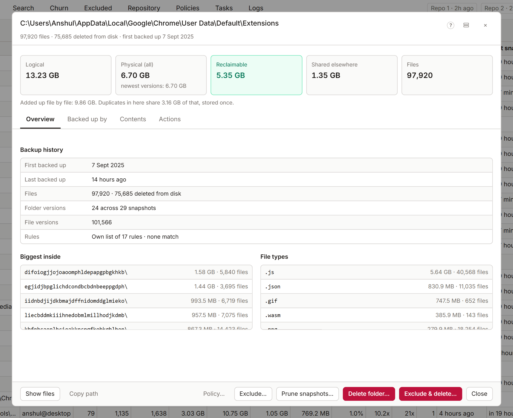

# Folder panel

The folder panel shows what one folder holds in your backups, what it costs in space, which sources back it up, and what you can do with it. Open it with **Details** on any folder in the Tree, Search or Churn.

## The summary

| Figure | What it means |
|---|---|
| **Logical** | The folder's size, as on disk |
| **Physical (all)** | The space every version of every file in it takes. Until the exact figure arrives, it adds up the files one by one, so duplicates count twice |
| **Physical**, newest versions | The space the newest versions take |
| **Reclaimable** | The space deleting the folder from the backups gives back. It shows **working…** while KopiaLens works it out |
| **Shared elsewhere** | Data that stays stored after a delete, because files elsewhere use the same pieces |

When a figure comes from an earlier index, the panel says so and works out a fresh one in the background.

## Backed up by

This section lists the sources that back up the folder:

- The sources that back up this folder itself.
- The folder policies below it, which add their own rules.
- Each source's retention, and the exclusion rules that apply here (**Ignore rules here**).

When more than one source backs up the folder, deleting it from one source leaves the copies in the others. When sources are nested (one inside another), some files are snapshotted more than once, and the panel says so.

## Contents

- **Inside this folder** lists the folders and files directly inside it, with their physical size, files, versions and when they were last backed up. Sort by **Folders first** or **Largest first**. Items deleted from disk are marked. The list shows the first 500. Select an item to open it.
- **File types** breaks the folder down by extension. Select a type to see those files in Search.
- **Biggest inside** lists the biggest items anywhere below it.

## What you can do

| Action | What it does |
|---|---|
| **Prune snapshots…** | Keep the snapshots you want and remove the folder from the rest, with what each one frees ([Prune versions](prune.md)) |
| **Delete folder…** | Removes everything under the folder from the backups, with a dry run before anything happens ([Delete from backups](delete-files.md#delete-a-folder)) |
| **Exclude…** | Keeps the folder out of future snapshots ([Exclude](exclude.md)) |
| **Exclude & delete…** | Both: no future snapshots, and removed from the old ones |
| **Restore**, **Download**, **Mount** | Gets the folder back from the latest snapshot that holds it ([Restore, download and mount](restore.md)) |
| **Show files** | Lists the folder's files in [Search](search.md) |
| **Copy path** | Copies the folder's path |
| **Policy…** | Opens the policy that rules this folder in a popup ([Policies](policies.md#edit-a-policy-from-other-screens)). Each source under **Backed up by** has its own **Policy…** |

**Prune snapshots…**, **Delete folder…** and **Exclude & delete…** are [Pro](licensing.md) actions. Their previews are free.

## Several items at once

Select several rows in the Tree or Search, then right-click and choose **Details of …**. The panel then lists the items and the sources that hold them, with their totals. **Restore…**, **Exclude…**, **Delete…** and **Exclude & delete…** act on all of them. **Copy paths** copies every path.

## Layout

In the **Tabbed** layout (**Settings → Appearance → Detail panel layout**), the panel groups its sections under **Overview**, **Backed up by**, **Contents** and **Actions**.

## Related

- [File panel](file-panel.md)
- [Delete from backups](delete-files.md)
- [How KopiaLens counts space](space.md)
