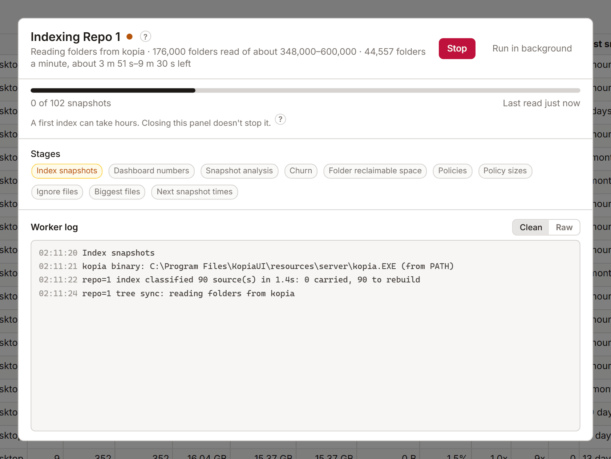

# Indexing

KopiaLens reads your snapshots from kopia and keeps what it learns in its own [index](glossary.md#index), on the computer running KopiaLens. Search, the Tree, the space columns and the delete plans all read the index, which is why they answer in a moment. Without it, each of those answers would mean reading through every snapshot again. This page explains how the index is built and kept current.

Indexing only reads the repository. It never changes your backups. [How indexing works](how-indexing-works.md) explains what it reads and why.

## First index

The first index reads every snapshot in the repository, so it takes the longest. Depending on the repository's size and where it is stored, it takes from minutes to many hours. Repositories on cloud storage take longer, because kopia downloads what it reads.

- You can keep using KopiaLens while it runs. Closing the indexing panel doesn't stop it.
- With several repositories, they're indexed one after another.
- If it stops, for any reason, the next run continues from where it was.

First-time setup shows an estimate before it starts ([First-time setup](getting-started.md#3-build-the-index)).

After the first index, each run reads only what changed: the snapshots taken since the last run. That usually takes minutes.

## When the index updates

By default, KopiaLens updates the index once a day at 23:00. Change it in **Settings → Indexing → Kopia indexing**:

- **Once a day, at a set time**.
- **Every N hours**: every 4, 6, 12 or 24 hours.
- **Off, only when I start it**.

Indexing runs one repository at a time, in its own process, so KopiaLens stays light while it runs. If the computer was off at the set time, the run starts at the next opportunity. A failed run is tried once more after 15 minutes (**Settings → Advanced**).

After you delete files or snapshots, KopiaLens updates the index on its own 5 minutes after the last delete. Back-to-back deletes share one update.

To update the index now, select **Index** in the top bar. For a repository that has never been indexed, the button says **Index now**.

### Pause indexing

**Pause indexing** in **Settings → Indexing** (or the tray menu) stops automatic runs for a while, or until you resume. The top bar then shows **Indexing paused** with a **Resume** button. The pause is kept when KopiaLens restarts.

While paused, these wait: scheduled index runs, the update after deletes, the daytime Dashboard rebuild and the Backblaze update. Anything you start yourself still runs. A run that was due during the pause starts soon after it ends.

## How fresh the index is

The top bar shows the index state of the repository you're looking at, for example **Index 7552/7572**: 7552 of the repository's 7572 snapshots are indexed. Snapshots taken since the last run aren't in the index yet.

Next to the tabs, a small chip per repository shows when it was last indexed, for example **Repo 1 · 20h ago**. A chip turns amber when an index run seems to have been missed, and shows **!** when the last run failed. Hover over a chip to see the reason.

When an update finishes while you work, **Index updated** appears with a **Reload** button. Select it to see the new numbers.

## The indexing panel

Select the index state in the top bar to open the indexing panel. It shows:

- The snapshots indexed so far, and a time estimate where KopiaLens has one.
- The **Stages** and which one is running.
- What kopia is doing now, for example how many folders it has read.
- The **Worker log**. **Clean** hides timing lines. **Raw** shows everything.

**Run in background** closes the panel and leaves the run going. **Stop** stops it (see below).

The stages are:

| Stage | What it does |
|---|---|
| Index snapshots | Reads the new snapshots' folders and files from kopia |
| Dashboard numbers | Works out the Dashboard's space columns |
| Snapshot analysis | Works out each snapshot's churn and reclaimable space |
| Churn | Builds the Churn tab's figures |
| Folder reclaimable space | Works out the biggest folders' reclaimable space ahead of time |
| Policies | Reads the repository's policies and checks KopiaLens's copy of the retention rules |
| Policy sizes | Works out what each exclusion rule keeps out |
| Ignore files | Finds rule files such as `.kopiaignore` |
| Biggest files | Ranks the files with the most stored space, for Search's sorting |
| Next snapshot times | Works out when each source is backed up next |

## Stopping an index

You can stop an index at any time from the indexing panel. What KopiaLens has already read from kopia is saved, and the next run continues from there. Once the read is finished, a stop or a crash never makes KopiaLens read the repository again. The next run only reads snapshots taken since.

The same happens when a run reaches its time limit (**Settings → Advanced**).

## Time limits and stuck runs

These settings are in **Settings → Advanced**:

| Setting | Default | What it does |
|---|---|---|
| **Indexing time limit** | 4 hours | A run that takes longer is stopped. The next run continues where it left off |
| **First index time limit** | 24 hours | The same for a first index. Time the computer sleeps doesn't count |
| **Give up on an unreachable repository after** | 30 minutes | A drive unplugged or a cloud store offline in the middle of a run. The run stops, keeps its progress, and the next repository can index |
| **Stop an index that makes no progress after** | 60 minutes | Slow is fine. No progress at all for this long means stuck. 0 turns it off |
| **When quitting KopiaLens** | Let indexing finish | Or **Stop indexing**. A stopped run is tried again later |

## Full rebuild

**Rebuild full index** in **Settings → Indexing** reads every snapshot again instead of only what changed. It's rarely needed and much slower. Use it only if the numbers look wrong after a normal update.

## Index backups

Find these in **Settings → Indexing → Index backups**.

- **Keep older versions**: KopiaLens keeps this many earlier versions of each repository's index (1 by default, up to 3, or Off for none). Each one takes extra disk space, up to the size of the index itself. Settings shows how much they use.
- **Copy to a folder**: a copy of each index in a folder you choose, updated after every index run. Pick a folder on another drive, so the copy survives if the drive holding KopiaLens's data fails. **Copy now** makes the first copy straight away. In Docker, the folder must be on a mounted volume.

If the current index is damaged (a file is missing or broken), KopiaLens switches to the newest good version on its own, first from the older versions, then from the copy folder, and shows a notice. The next index run brings it up to date in minutes instead of reading the whole repository again.

Copies follow your encryption setting. When you change it, the older versions and the folder copy are converted too.

## Related

- [How indexing works](how-indexing-works.md)
- [Hardware and memory](hardware.md)
- [Settings](settings.md#indexing)
