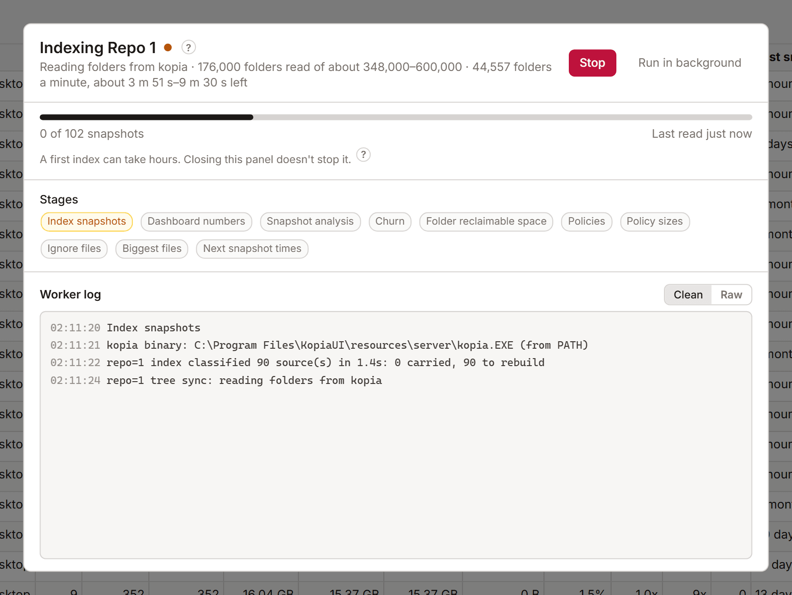

# Indexing

This page is still to be written.

## First index

To be written.

## Stopping an index

You can stop an index at any time from the indexing panel. What KopiaLens has already read from kopia is saved, and the next run continues from there. Once the read is finished, a stop or a crash never makes KopiaLens read the repository again; the next run only reads snapshots taken since.

The same happens when a run reaches its time limit (Settings > Advanced).

## Index backups

Settings > Indexing > Index backups.

- **Keep older versions**: KopiaLens keeps this many earlier versions of each repository's index (1 by default, up to 3; Off keeps none). Each one takes extra disk space, up to the size of the index itself; Settings shows how much they use.
- **Copy to a folder**: a copy of each index in a folder you choose, updated after every index run. Pick a folder on another drive, so the copy survives if the drive holding KopiaLens's data fails. **Copy now** makes the first copy straight away. In Docker, the folder must be on a mounted volume.

If the current index is damaged (a file is missing or broken), KopiaLens switches to the newest good version on its own, first from the older versions, then from the copy folder, and shows a notice. The next index run brings it up to date in minutes instead of reading the whole repository again.

Copies follow your encryption setting. When you change it, the older versions and the folder copy are converted too.
