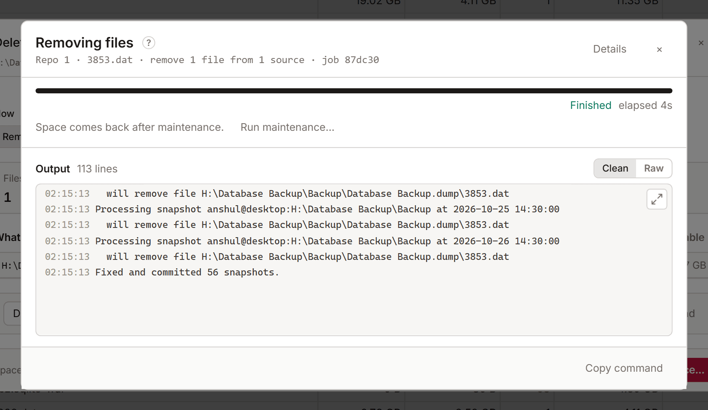

# Job panel

Every action that changes something, and every dry run, runs as a [job](glossary.md#job). The job panel opens when a job starts. It shows the job's progress and kopia's output, and what the job did when it ends.

## While a job runs

The panel shows what the job is (a dry run is marked **dry run**), how long it has run, and its progress where kopia reports one.

- **Stop** stops the job. KopiaLens ends kopia straight away. Work that kopia finished before the stop stays done, so a delete stopped part-way may already have changed some snapshots.
- **Run in background** closes the panel. The job keeps running, and a chip in the top bar shows it. Select the chip to open the panel again.

## Output

**Output** shows kopia's own messages as the job runs. **Clean** hides lines that only report timing. **Raw** shows everything. Use the arrow to make the output bigger or smaller.

- **Copy command** copies the kopia commands the job ran.
- **Open folder** opens the job's folder, for example a restore's destination. It shows where KopiaLens can open a file manager.

## When a job ends

The panel shows the result:

- After a delete: **Freed**, and the repository's size now. The space comes back after maintenance, so the panel offers **Run maintenance…** ([Maintenance](maintenance.md)).
- After **Exclude & delete**: the rules saved to each policy, then the delete. If a rule couldn't be added, the delete didn't run, and the panel says so. If kopia stored something different from what was written, the panel tells you to check the Policies tab.

A finished job stays in the [Tasks](tasks.md) tab and in **Logs → Activity**. Its full log is kept in the data folder, under `logs/jobs` ([Logs](logs.md)).

## Related

- [Tasks](tasks.md)
- [Logs](logs.md)
- [Glossary: dry run](glossary.md#dry-run)
