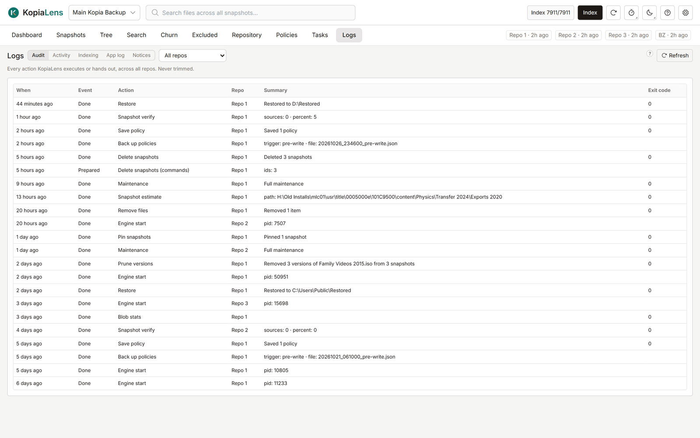

# Logs

The Logs tab shows what KopiaLens did: the changes it made, the jobs it ran, every index run, and its own log. Use it to check what happened and when, or to find the cause of a problem.

## The five logs

| Log | What it holds |
|---|---|
| **Audit** | Every action KopiaLens ran or prepared, in every repository: deletes, restores, pins, policy changes, mounts and more. Each row has the time, what happened, the repository, a summary and kopia's exit code. The audit log is never trimmed |
| **Activity** | Past jobs: deletes, restores, dry runs and the rest, with their state, progress and how long they took. Kept on disk, so the history survives a restart |
| **Indexing** | Every index run: when it finished, what started it, the result, how long it took, and the time per stage. Runs that timed out or were stopped appear too |
| **App log** | What the app did and what went wrong, newest first. Pick a level: **Everything**, **Info and above**, **Warnings and errors** or **Errors only**. With the debug log on, you can also switch to **Debug log** |
| **Notices** | The messages this window showed, newest first. Cleared when the page reloads |

The list at the top shows **All repos** or one repository. Select **Refresh** to read the logs again.

## Where the files are

The logs live in the KopiaLens data folder, under `logs`:

- `logs/app`: the app log and the debug log, with older copies.
- `logs/indexing`: one log per repository's index runs.
- `logs/jobs`: one log per job, dry run and mount.
- `logs/kopia`: kopia's own logs for the kopia commands KopiaLens runs, kept apart from your usual kopia logs. kopia clears old ones itself.

Old job logs are removed after 90 days by default. The newest 100 are always kept. Change it in **Settings → Advanced → Log cleanup**.

To turn on the debug log, use **Settings → Advanced → Debug log**. It writes detailed diagnostics beside the normal log. Leave it off unless you're looking for a problem.

To send logs with a problem report, use **Create diagnostics bundle…** in the Help menu ([Getting help](getting-help.md#diagnostics-bundle)).

## Related

- [Tasks](tasks.md)
- [Indexing](indexing.md)
- [Getting help](getting-help.md)
