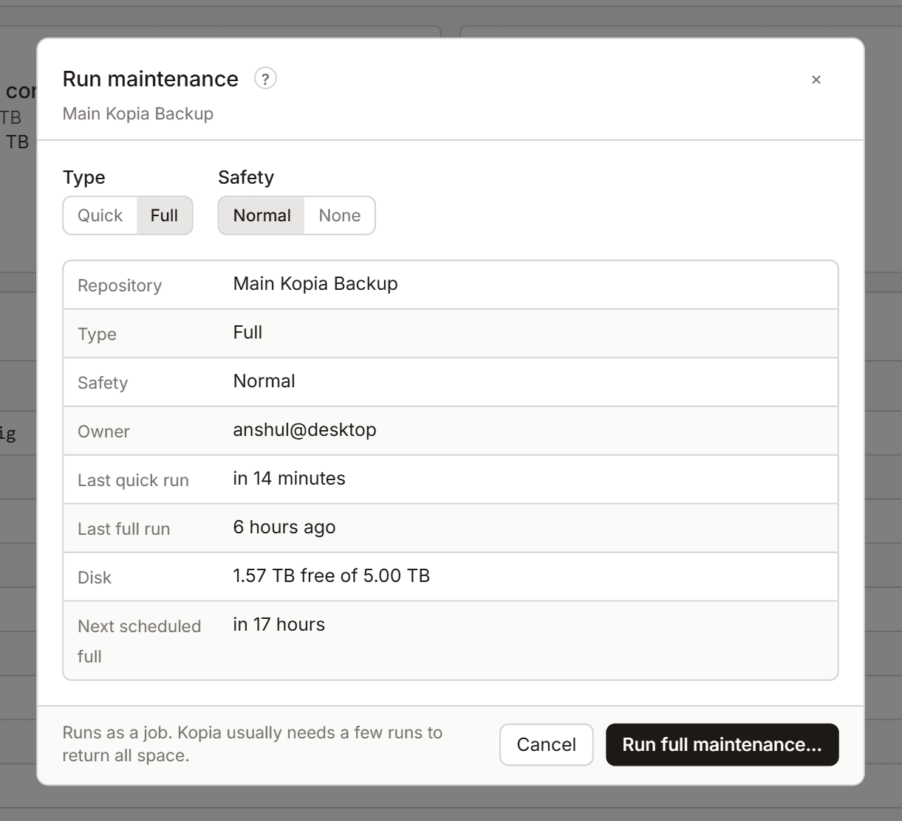

# Maintenance

[Maintenance](glossary.md#maintenance) is kopia's housekeeping. Full maintenance deletes data that no snapshot uses any more, which is when the space from a delete comes back. Kopia runs maintenance on its own schedule. You can also start it by hand.



## Run maintenance by hand

Open it with **Run maintenance…** in the Repository tab, or from the job panel after a delete. Running maintenance needs the **Non-destructive** permission or higher ([Permissions](settings.md#permissions)).

1. Choose the **Type**:
   - **Quick**: index and cache housekeeping. Frees little space.
   - **Full**: deletes data that no snapshot uses any more.
2. Choose the **Safety**:
   - **Normal** (the default): kopia waits before it deletes unused data, so the space returns over later runs.
   - **None**: deletes unused data now.
3. Select **Run full maintenance…** or **Run quick maintenance…** and confirm.

Maintenance runs as a job in the [job panel](job-panel.md). A full run after a large delete can take hours. It keeps running in the background.

**Warning:** with **Safety: None**, kopia deletes unused data at once, without its usual wait. If a snapshot is running on this repository at the same time, from this computer or another, that snapshot can lose data. Use **None** only on a repository that only you use, when no snapshot is running.

## Why the space comes back later

With **Normal** safety, kopia deletes a piece only after two full maintenance runs, some hours apart, have both found it unused. This protects a snapshot that is running at the same time. So one full run usually isn't enough. Kopia needs a few runs to return all the space ([When the space comes back](space.md#when-the-space-comes-back)).

The panel shows when the next scheduled full run is due.

## Who can run it

Kopia lets only one user and computer run maintenance on a repository: the [maintenance owner](glossary.md#maintenance-owner). If this computer isn't the owner, the panel says so and won't start a run. Run maintenance from the owner's computer instead, or make this computer the owner with kopia's command line:

```
kopia maintenance set --owner=me
```

Change the owner only when the old owner no longer runs maintenance. Two computers that both think they own it can run maintenance at the same time.

When KopiaLens runs a repository's backups and this computer is the owner, KopiaLens runs maintenance on kopia's schedule too ([Who runs backups](backups.md#who-runs-backups)).

## Related

- [How KopiaLens counts space](space.md#when-the-space-comes-back)
- [Repository](repository.md)
- [Why deleting frees space only after maintenance](deleting-and-space.md)
