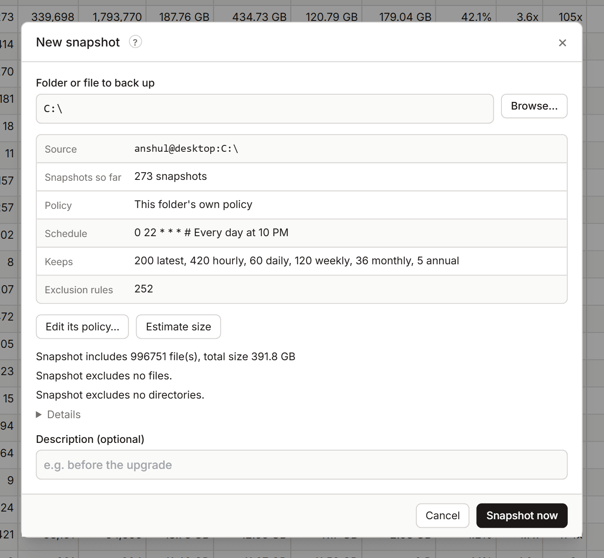

# New snapshot

**New snapshot…** backs up any folder or file now: one you already back up, or a new one. It shows which policy will apply and estimates the size before you start. Open it from the Dashboard.

Taking a snapshot needs the **Non-destructive** permission or higher ([Permissions](settings.md#permissions)).

## Take a snapshot

1. In **Folder or file to back up**, type the path or select **Browse…**. The path is on the computer running KopiaLens. In Docker, it's the path inside the container.
2. Check what KopiaLens found:
   - **Source**: the source this path becomes, as `user@computer:path`.
   - **Snapshots so far**: how many it has, or **None, this is the first**.
   - **Policy**: which policy applies (its own, inherited from a parent folder, or the Global policy), its **Schedule**, what it **Keeps**, and how many **Exclusion rules** apply.
3. Optional: select **Estimate size**. Kopia walks the folder and reports how much it includes and excludes, and how long the upload might take. **Stop** ends the estimate.
4. Optional: enter a **Description**, for example `before the upgrade`.
5. Select **Snapshot now**.

The snapshot runs as a job in the [job panel](job-panel.md). Later backups of this folder follow its policy's schedule.

## Change the policy first

Before the first snapshot, you may want different rules for this folder: other exclusions, retention or a schedule.

- **Give it its own policy…** opens the policy editor in a popup with a new policy for this folder.
- **Edit its policy…** opens the policy it already has.

New snapshot stays open underneath. After you save, it shows the new policy.

## Who runs later backups

Later snapshots of the folder follow its policy's schedule. They're taken by the app that runs this repository's backups: KopiaLens, or another app such as KopiaUI ([Who runs backups](backups.md#who-runs-backups)). A policy with **Manual only** in its schedule is never backed up on a schedule.

## Related

- [Start backing up from scratch](guide-start-from-scratch.md)
- [Backups](backups.md)
- [Policies](policies.md)
