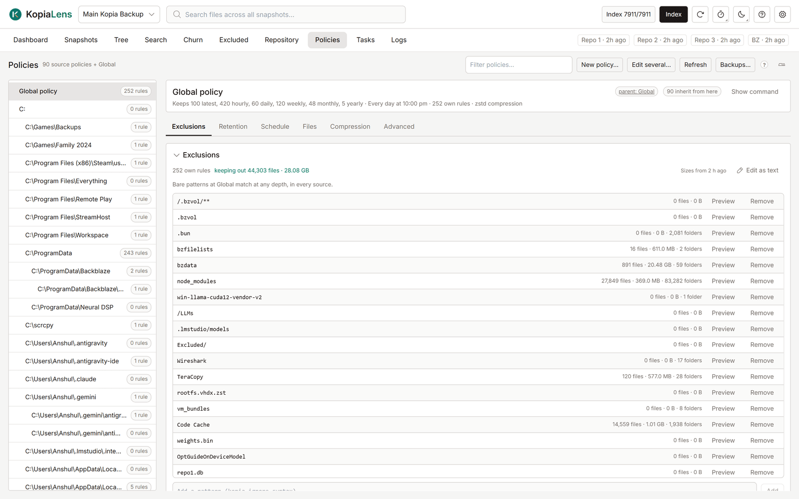

# Policies

A [policy](glossary.md#policy) holds kopia's rules for a folder: what to leave out, how many snapshots to keep, when to back up, and how to compress. The Policies tab lists every policy in the repository and lets you change them. Nothing reaches kopia until you review and save.

## How policies apply

Kopia looks for the policy closest to a folder:

1. A policy on the folder itself, or on a folder above it.
2. A policy for the user and computer (`user@computer`), or for every user on that computer (`@computer`).
3. The **Global policy**, which every source falls back to.

A setting a policy doesn't set comes from the next policy up. The header of each policy shows its parent and how many policies inherit from it.

**Exclusion rules work differently.** A policy that has its own exclusion rules doesn't add them to the rules above it: they replace them for that source. So a source with one rule of its own no longer gets the Global rules. One more case: when kopia walks into a subfolder that has its own policy, that policy's rules are added for that subfolder. KopiaLens shows both: the policy's own rules, and the inherited rules that apply.

When you add an exclusion from the Tree, Search or a panel, KopiaLens puts it in the policy the source already gets its rules from, so no inherited rules are lost ([Exclude](exclude.md)).

## The policy list

The list on the left has the **Global policy**, then **Folder policies**, then **User and computer policies**. Each shows how many exclusion rules it has. Type in **Filter policies…** to find one. Drag the list's edge to make it wider.

Select a policy to open it. The line under its name sums it up: what it keeps, when it backs up, its rules and its compression.

## Exclusions

The **Exclusions** section lists the policy's own rules. For each rule, KopiaLens shows how many files, how much data and how many folders it keeps out of the backups, from the last index run. **keeping out** at the top gives the total.

- **Add a pattern** adds a rule, written in kopia's ignore syntax (for example `node_modules`, `*.tmp` or `/Downloads`). A rule without `/` at the Global policy matches at any depth, in every source.
- **Preview** shows what a rule matches: **On disk now** (what it keeps out of the next snapshot) and **In the backups** (backed-up files it would drop from the next snapshot).
- **Remove** takes a rule out.
- **Work out sizes** prices rules that have no size yet.
- **Edit as text** shows the policy's own rules in one box, one rule per line. Select **Apply** to stage the changes. kopia reads the rules from the top, and a rule starting with `!` brings back only what a rule above it left out. So the order you type is saved too. **new order, not saved** shows above the list until you save, and **Undo order** puts the old order back.

**Inherited rules** lists the rules that come from policies above, read-only. To change one, select **Jump there** to open the policy that owns it.

**Ignore files** lists rule files kopia finds inside the folders, such as `.kopiaignore`. They are read-only here. Edit them on disk. **not in effect** means kopia doesn't read that file at this place.

## The other sections

**Retention**, **Schedule**, **Files**, **Compression** and **Advanced** hold the rest of kopia's policy settings. A blank field inherits from the policy above, and the editor shows the value in effect and where it comes from. Each field is described in [Policy editor](policy-editor.md).

## Review and save

Every change is staged first. The tab shows **not saved** next to it, and **Undo** takes one change back. To write the changes:

1. Select **Review and save…**.
2. Check the list. It shows each setting as it will be written. **Copy command** copies the kopia command.
3. Select **Save changes**.

Before each write, KopiaLens backs up the repository's policies and checks that the backup can be read. If kopia would refuse a change, the review says so before anything is written.

If you leave a policy with unsaved changes, KopiaLens asks first. To keep them as a draft instead, change **Leaving a policy with unsaved changes** in **Settings → Appearance**.

## Edit a policy from other screens

The same editor opens in a popup from other screens, so you don't lose your place:

- **Policy** on a Dashboard row, and **Open policy** in its right-click menu.
- **Give it its own policy…** or **Edit its policy…** in [New snapshot](new-snapshot.md).
- **Policy…** in the file and folder panels, and on each source under **Backed up by**.
- **Policy…** in a row's right-click menu on the [Excluded](excluded.md) tab.

The panels and Excluded open the policy that rules that path: the closest folder policy or source above it, else the Global policy. Unsaved changes are shared with the Policies tab. Close the popup and they stay there until you save or discard them. **Open in Policies** switches to the tab.

## Other actions

| Action | What it does |
|---|---|
| **New policy…** | Creates a policy for a **Folder** or for a **Computer and user**. It applies to that folder and everything below it |
| **Edit several…** | Pick two or more policies and set the same settings on all of them at once. Only the settings you change are written. Exclusion rules stay per policy |
| **Remove policy…** | Removes the whole policy. The folder then uses the settings it inherits |
| **Backups…** | Lists the policy backups: one before every write, and one each night when something changed. **Review restore…** shows what a backup would change |
| **Refresh** | Reads the policies from kopia again |

A restore from a backup has two modes:

- **Merge**: the policies in the backup replace their current versions. Other policies stay.
- **Mirror**: the repository ends up with exactly the policies in the backup. Every other policy is removed.

KopiaLens backs up the current policies before it restores, and restores only backups it made itself.

## Related

- [Policy editor](policy-editor.md)
- [Exclude](exclude.md)
- [Simulate](simulate.md)
