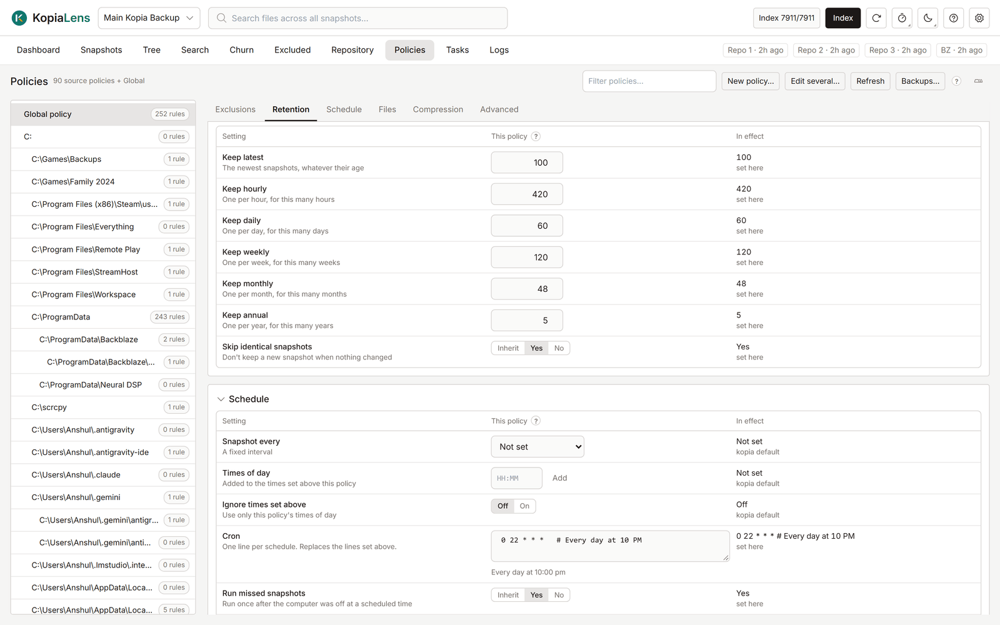

# Policy editor

The policy editor holds every kopia policy setting, in six sections on the [Policies](policies.md) tab: **Exclusions**, **Retention**, **Schedule**, **Files**, **Compression** and **Advanced**. This page describes each setting. Changes are staged until you review and save them ([Review and save](policies.md#review-and-save)).

## How fields work

- A blank field **inherits** its value from the policy above ([How policies apply](policies.md#how-policies-apply)).
- Beside each field, the editor shows the value **In effect** and where it comes from: **set here**, or **from** the policy that sets it.
- A changed field is marked, and **Undo** next to it takes the change back.
- Some fields add to the values set above (marked **Added to** in the field's help). Their **Ignore … set above** switch uses only this policy's values.

**Policy editor layout** in **Settings → Appearance** shows one section at a time (**Tabs**) or every section stacked (**Scroll**).

## Exclusions

The rules that keep files out of snapshots. See [Exclusions](policies.md#exclusions).

## Retention

How many snapshots kopia keeps. Kopia keeps a snapshot when any rule keeps it.

| Setting | What it keeps |
|---|---|
| **Keep latest** | The newest snapshots, whatever their age |
| **Keep hourly** | One per hour, for this many hours |
| **Keep daily** | One per day, for this many days |
| **Keep weekly** | One per week, for this many weeks |
| **Keep monthly** | One per month, for this many months |
| **Keep annual** | One per year, for this many years |
| **Skip identical snapshots** | Don't keep a new snapshot when nothing changed |

**What the new retention keeps** counts, for each source, how many snapshots the changed rules keep and how many they drop. Kopia deletes the dropped ones the next time it takes a snapshot of that source. Pinned snapshots are always kept. [Simulate](simulate.md) shows the space this frees.

## Schedule

When kopia takes snapshots. Only the app that runs the repository's backups follows the schedule ([Who runs backups](backups.md#who-runs-backups)).

| Setting | What it does |
|---|---|
| **Snapshot every** | A fixed interval, from 10 minutes to 2 days |
| **Times of day** | Set times, for example 09:00 and 21:00. Added to the times set above this policy |
| **Ignore times set above** | Use only this policy's times of day |
| **Cron** | One line per schedule, in cron format. Replaces the lines set above. The editor shows what each line means |
| **Run missed snapshots** | Take one snapshot after the computer was off at a scheduled time |
| **Manual only** | Never back up on a schedule. Can't be combined with the other schedule settings |

**Next snapshots** lists the next times the schedule gives.

Two kopia rules to know about cron lines: kopia reads `#` as the start of a comment, so `0 12 * * FRI#2` runs every Friday. And kopia works intervals out on UTC time, so an hourly schedule can land at half past the hour in some time zones.

## Files

| Setting | What it does |
|---|---|
| **Rule files** | File names that hold extra exclusion rules, such as `.kopiaignore` |
| **Ignore rule files set above** | Use only this policy's rule files |
| **Skip cache folders** | Leave out folders marked with a `CACHEDIR.TAG` file |
| **Skip files larger than** | Leave out files bigger than this |
| **Stay on one drive** | Don't follow into other drives mounted inside the folder |

## Compression

| Setting | What it does |
|---|---|
| **Compression** | How file data is compressed, for example `zstd` |
| **Metadata compression** | How folder listings and other metadata are compressed |
| **Only compress** | Extensions to compress. Added to the list set above |
| **Never compress** | Extensions to store as they are. Added to the list set above |
| **Smallest file to compress**, **Largest file to compress** | Files outside these sizes are stored as they are |

Compression changes apply to data uploaded from now on. Data already stored isn't compressed again.

## Advanced

### Error handling

**Ignore file read errors**, **Ignore folder read errors** and **Ignore unknown file types** (sockets, devices and similar). When on, a file or folder that can't be read doesn't fail the snapshot.

### Upload

| Setting | What it does |
|---|---|
| **Snapshots at the same time** | How many snapshots run at once. Only the Global policy or a user or computer policy can set it |
| **Files read at the same time** | Blank means automatic |
| **Upload in parts above** | Files bigger than this upload in parallel parts |

### Snapshot scripts

Commands kopia runs around a snapshot: **Before snapshot** and **After snapshot** for the whole snapshot, and **Before this folder** and **After this folder**, which apply only to this policy and are never inherited. Each takes a program or script path, arguments and a timeout in seconds. Choose **Must succeed** (the snapshot fails if the script fails), **Optional**, or **Run in background**.

Kopia runs scripts only on a computer whose connection allows it. When it's off, the section says so and offers **Turn on scripts** ([Snapshot scripts](backups.md#snapshot-scripts)).

### Windows shadow copy

**Use shadow copy**: **Never**, **When available** or **Always**. A shadow copy backs up open or locked files from a frozen copy of the drive. It works on Windows only, and kopia needs administrator rights to make one.

### Splitter

**Splitter override** changes how files are cut into pieces. Changing it makes new data deduplicate badly against data already stored, so leave it unless you know you need it.

### Logging

How much kopia writes to its log about **Folders backed up**, **Folders skipped**, **Files backed up**, **Files skipped**, **Files unchanged** and **Files read again**. Each is a detail level from 0 to 10.

### Inheritance

**Stop applying parent policies**: nothing above this policy applies here, kopia's own defaults included. Use it with care: a setting this policy leaves blank is then not set at all, so it doesn't inherit a value from anywhere.

**Raw policy** shows the policy as kopia stores it.

## Related

- [Policies](policies.md)
- [Simulate](simulate.md)
- [Test a retention policy before using it](guide-test-retention.md)
