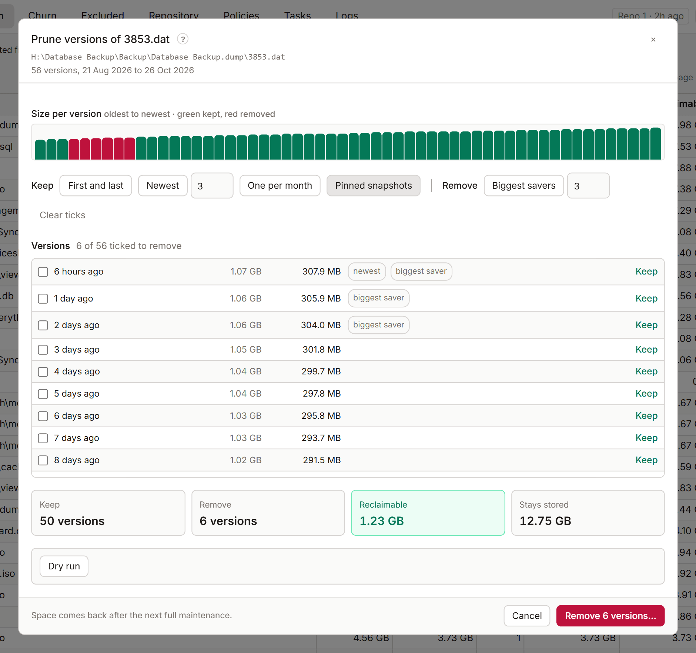

# Prune versions

Prune removes old versions of one file or folder from your snapshots and keeps the ones you choose. The snapshots stay, and so does everything else in them. Use it when a big file has many versions and you only need a few. Prune is a [Pro](licensing.md) action. Its figures are free.

## Open it

- On a file or folder in the Tree or Search, right-click and select **Prune versions…**.
- In the file panel, select **Prune versions…** under Versions.
- In the folder panel, select **Prune snapshots…**.
- In the Repository tab, **Versions worth pruning** lists good candidates.

KopiaLens first reads every snapshot that holds the file or folder.

## Pick what to keep

The chart shows the size in each snapshot, oldest to newest: green is kept, red is removed. Below it, each snapshot is one row with what removing it frees on its own. Tags mark the **newest**, the **first**, **pinned** snapshots and the **biggest saver**.

Use the quick picks, then adjust single rows with **Keep** or **Remove**:

| Pick | What it ticks |
|---|---|
| **Keep: First and last** | Keeps the oldest and the newest |
| **Keep: Newest** | Keeps the newest few. Enter how many |
| **Keep: One per month** | Keeps one version per month |
| **Keep: Pinned snapshots** | Pinned snapshots stay, whatever else you pick |
| **Remove: Biggest savers** | Removes the versions that free the most on their own. Enter how many |

**Clear ticks** starts again.

The total at the bottom shows what removing the ticked versions frees, and what **Stays stored** because other files use the same data.

## Things to know

- **also elsewhere**: identical content sits at another path too, so it stays stored there.
- **whole snapshot**: the folder is the source's whole backup. Removing it deletes that snapshot.
- If the same version sits at another path in the same snapshots, it's removed there too. The panel says so.
- When several sources on this computer back up the path, the removal covers all of them. Sources from other computers that hold the path stay as they are, and the panel says how many.
- **couldn't read** means kopia couldn't read that snapshot. The figures may then be off.

## Run it

1. Select **Dry run**. Kopia lists what it would remove without changing anything.
2. Select **Remove** (the button names how many versions) and confirm.

The removal runs as a job in the [job panel](job-panel.md). The space comes back after the next full maintenance ([When the space comes back](space.md#when-the-space-comes-back)).

## Related

- [File panel](file-panel.md)
- [Delete from backups](delete-files.md)
- [Clean up after a huge accidental backup](guide-accidental-backup.md)
