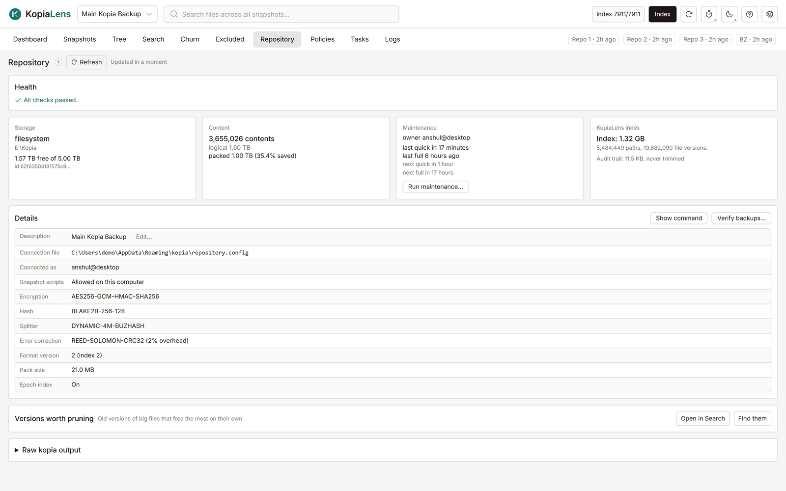

# Repository

The Repository tab shows the repository itself: its health, storage, maintenance and settings. Check it when something looks wrong, or before you run maintenance.

## Health

The **Health** card lists anything that needs attention. **All checks passed.** means none of these were found:

- This connection can't run maintenance, because another user or computer is the [maintenance owner](glossary.md#maintenance-owner).
- Snapshots in the repository use a different spelling of this computer's name, or two spellings.
- Full maintenance is turned off, has never run, or hasn't run for many days. Space from deleted data isn't freed until it runs.
- The repository has no KopiaLens index yet.
- The drive or volume holding the repository is nearly full.
- The repository grew a lot in the past week.
- KopiaLens's retention check disagrees with kopia for some sources.

Where a fix is a kopia command, **Copy fix** copies it.

## The cards

| Card | What it shows |
|---|---|
| **Storage** | The storage type (for example `filesystem`, `s3`), where the repository is, and the free space where KopiaLens can read it |
| **Content** | How many pieces the repository stores, their total size before and after compression, and the change over 7 days |
| **Maintenance** | The maintenance owner, when maintenance last ran, and when the next quick and full runs are due. **Run maintenance…** starts one ([Maintenance](maintenance.md)) |
| **KopiaLens index** | The size of KopiaLens's index for this repository, how many paths and file versions it holds, and the size of the audit trail |

Select **Refresh** to read the numbers again from kopia.

## Details

The **Details** table lists the repository's settings as kopia reports them:

| Row | What it means |
|---|---|
| **Description** | The repository's name in KopiaLens and KopiaUI. **Edit…** changes it |
| **Connection file** | The [connection file](glossary.md#connection-file) KopiaLens uses |
| **Connected as** | The user and computer this connection backs up as. **(read-only)** for a [read-only connection](glossary.md#read-only-connection) |
| **Snapshot scripts** | Whether this computer runs a policy's own commands before and after a backup ([Snapshot scripts](backups.md#snapshot-scripts)) |
| **Encryption**, **Hash**, **Splitter** | How kopia encrypts data, names pieces and cuts files into pieces. Chosen when the repository was created |
| **Error correction** | Extra data kopia stores to repair small storage errors, or **Off** |
| **Format version**, **Pack size**, **Epoch index** | kopia's storage format details |

**Show command** shows the kopia command behind the table. **Verify backups…** checks that your snapshots can be read ([Checking backups](backups.md#checking-backups)).

## Versions worth pruning

This list finds old versions of big files that free the most space on their own. Select **Find them**. Each row names the file, the version, its size and what deleting that version gives back. **Prune…** opens [Prune versions](prune.md) for that file.

The list needs an index. On a repository indexed for the first time, it's available after the next index run.

## Raw kopia output

**Raw kopia output** shows kopia's own text for the repository. **Run blob stats…** counts every stored file in the repository's storage. It's slow on large repositories and asks before it starts.

## Related

- [Maintenance](maintenance.md)
- [Repositories](repositories.md)
- [How KopiaLens counts space](space.md#when-the-space-comes-back)
