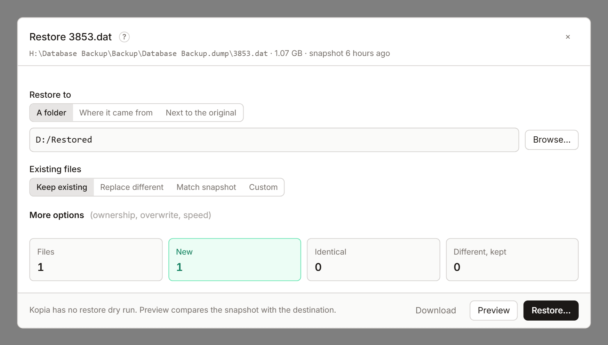

# Restore, download and mount

There are three ways to get files back from a snapshot: restore them to disk, download them, or mount the snapshot and copy what you need. None of them changes your backups.

## Restore

Restore writes files from a snapshot to a folder on the computer running KopiaLens.

Open it with **Restore…** on a file or folder in the Tree or Search, **Restore** on a version in the file panel, or **Restore this snapshot…** in the Snapshots tab. Restoring needs the **Restores allowed** permission or higher ([Permissions](settings.md#permissions)).

1. Check **From**: the snapshot the files come from. When more than one source holds the path, the one with the newest backup is picked.
2. Choose **Restore to**:
   - **A folder**: a folder you type or pick with **Browse…**. Files go straight into it, and files with the same name get a number. A path ending in `.zip` writes an uncompressed zip file instead.
   - **Where it came from**: back to the path it was backed up from.
   - **Next to the original**: a dated copy beside the original, for example `notes (2026-09-01).txt`.
3. Choose what happens to **Existing files**:
   - **Keep existing**: only add what is missing. Nothing is overwritten.
   - **Replace different**: replace files that differ from the snapshot. Extra files stay.
   - **Match snapshot**: replace files that differ and delete files the snapshot doesn't have.
   - **Custom**: set by **More options**.
4. Select **Preview**. Kopia has no restore dry run, so KopiaLens compares the snapshot with the destination and shows what would happen.
5. Select **Restore…** and confirm.

**Warning:** **Match snapshot** and **Delete extra files** delete files in the destination folder that the snapshot doesn't have. Check the preview's **Deleted from the destination** list first.

The restore runs as a job in the [job panel](job-panel.md).

### The preview

The preview counts the files that are **New**, **Identical** (same size and modified time), **Replaced**, **Different, kept** and **Deleted**. It lists names this computer can't use, which can stop a restore. Tick **Continue on errors** to skip them.

With more than 100,000 files, the preview checks the first 100,000. **Check all files** checks the rest, which can take a while.

### More options

**More options** has kopia's restore settings: **Restore ownership**, **Restore permissions**, **Restore modified time**, **Skip existing**, **Continue on errors**, **Write atomically**, **Sparse files**, **Ignore permission errors**, the overwrite options, **Delete extra files** and **Parallel**.

**Shallow depth** makes a shallow restore: folders deeper than this become small placeholder files instead of their contents, which kopia can restore in full later. **Full files under** restores files smaller than this size in full instead of as placeholders.

## Download

**Download** saves a file, or a folder as a zip file, through your browser. It downloads the latest backed-up copy, or the version you picked in the file panel.

- A folder's zip file is built on the computer running KopiaLens first, so that computer needs as much free space as the folder takes.
- KopiaLens asks before a big download.

## Mount

Mounting makes a snapshot appear as a read-only drive or folder, so you can open and copy files with your own tools.

- On Windows, a mounted snapshot gets a drive letter.
- On Linux and macOS, it appears in a folder inside the **Snapshot mount folder** (**Settings → General**).
- In Docker, mounting needs extra container settings ([Mounting snapshots](docker.md#mounting-snapshots)).

Mount from **Mount** on a snapshot, folder, file or version. When the computer running KopiaLens has a desktop (not Docker or a headless server), the item says **Mount + open in** its file manager, and the folder opens there too.

While a snapshot is mounted, the top bar shows **1 mounted** (or more). Select it to list the mounts, **Open** one, **Unmount** one or **Unmount all**.

## Related

- [Restore files](guide-restore-files.md)
- [File panel](file-panel.md)
- [Permissions](settings.md#permissions)
