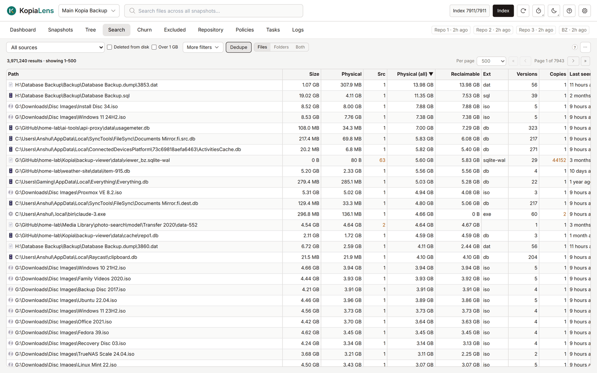

# Search

Search finds files and folders across every snapshot in the repository, including files since deleted from disk. Results come back in a moment, even in a repository with millions of files.

## Search for a file

Type part of a path in the search box at the top of the window, or in the Search tab's own box. KopiaLens lists every file whose full path contains that text.

- Upper and lower case don't matter: `report` finds `Report.docx`.
- The text is matched exactly as you type it. `*` and `?` are ordinary characters, not wildcards.
- With no text, Search lists every file, biggest first.

To use only the box at the top of the window, set **Search boxes** to **Header only** in **Settings → General**.

## Where to search

The list at the top left sets where Search looks:

- **All repositories**: every kopia repository connected to KopiaLens, in one list. A **Repo** column shows where each file is. Results stop at 20000 rows, and the Physical (all) and Reclaimable sorts aren't available. Narrow the search to see more.
- **All sources**: every source in this repository.
- One source.

## Files, folders or both

- **Files** lists files.
- **Folders** ranks folders by the space they take, to find the biggest ones. It works within one repository.
- **Both** lists files and folders together.

Min depth and Max depth set which folder levels to look at. A drive, a network share and `/` are level 1. The list next to them picks how folders are chosen:

- **Deepest folders**: folders at Max depth, each with everything inside it. A shallower folder with no subfolders is listed too. With **Loose files** ticked, a shallower folder that does have subfolders also gets a row for the files lying directly in it, marked *own files*.
- **Nested**: every folder from Min to Max depth, each with everything inside it. A folder and its subfolders can both appear, so their sizes overlap.
- **Own files**: every folder from Min to Max depth, counting only the files directly inside it. Nothing overlaps.

## What it shows

| Column | What it means |
|---|---|
| **Path** | The file's full path |
| **Size** | Its size, as on disk ([logical](glossary.md#logical)) |
| **Physical** | The space the newest version takes in the repository |
| **Src** | How many sources hold this content. Copies inside one source count once |
| **Physical (all)** | The space all its versions take together |
| **Reclaimable** | The space that removing every version of this file from every snapshot gives back |
| **Ext** | The file's extension |
| **Versions** | How many versions are backed up |
| **Copies** | How many paths hold exactly this content |
| **Last seen** | When a snapshot last held it |
| **First seen** | When it first appeared in a snapshot |
| **On disk** | **yes**, or **deleted** when the latest snapshot no longer holds it |
| **Source** | The source the file belongs to |

A number shown in a warning colour in **Src** or **Copies** means the same content sits in more than one place. Removing one copy frees nothing while the others remain ([How KopiaLens counts space](space.md#an-example)).

### Sorting by Physical (all) or Reclaimable

Each index run ranks the files with the most stored space exactly, so these two sorts are exact for the biggest files. The setting **Ranked files** in **Settings → Advanced** sets how many files are ranked (10000 by default). Files outside the ranked list come after it. Until the first index run has ranked them, both sorts fall back to Physical, and Search says so.

## Filters

**Deleted from disk** and **Over 1 GB** sit next to the source list. **More filters** has the rest:

| Filter | What it does |
|---|---|
| **Extensions** | Only these extensions, for example `iso, 7z` |
| **Hide** | Leave out these extensions, for example `mp4, mkv` |
| **First backed up** | When the file first appeared in a snapshot: in the last 24 hours, 7 days or 30 days |
| **Size (GB)** | A smallest and a largest size |
| **Last seen** | A date range for when a snapshot last held the file |
| **At least … versions** | Files with many versions, which often cost the most |
| **… paths with the same content** | Files whose exact content sits at this many paths or more |

Active filters show as chips above the results. Select **×** on a chip to clear that filter.

**Dedupe** shows each file once. What it merges is set in **Settings → General → Dedupe in Search merges**:

- **Same path**: one row per file path, even when nested sources back up the same file.
- **Identical content**: one row for all files with the same bytes, wherever they are.

### Folder filters

In **Folders** view, these filters apply:

- **Min depth** and **Max depth**: how deep in the folder structure to rank.
- **Min GB** and **Min files**: hide small folders.
- **Loose files as their own rows**: a folder above **Max depth** that has subfolders gets an extra row for the files lying directly in it.

## What you can do

Right-click a file for **Details** ([File panel](file-panel.md)), **Show in Tree**, **Show source in Snapshots**, **Restore…**, **Download**, **Mount** (latest), **Exclude…**, **Prune versions…**, **Delete from backups…**, **Exclude & delete…**, **Copy path** and **Copy source**.

Right-click a folder for **Details** ([Folder panel](folder-panel.md)), **Show its files**, **Work out reclaimable space again**, **Delete folder from backups…** and **Copy path**.

To act on several rows, select them with Ctrl or Shift and right-click.

The **…** menu has **Export CSV** for this page or for all results. **Delete all … matching…** deletes every file the search matches from the backups ([Delete from backups](delete-files.md)). It is offered for up to 100000 files. For a bigger match, narrow the search first.

## Ready-made views

The **…** menu lists **Ready-made views**. **Old versions that free the most** lists the old versions of files whose removal gives back the most space, biggest first. Each row has **Prune…** ([Prune versions](prune.md)). Sorting, columns and **Export CSV** work as in any search. **Back to Search** returns to your results.

The same list starts from **Open in Search** in the **Versions worth pruning** box on the [Repository](repository.md) tab.

## Related

- [Tree](tree.md)
- [How KopiaLens counts space](space.md)
- [Find what's using the most space](guide-find-space.md)
