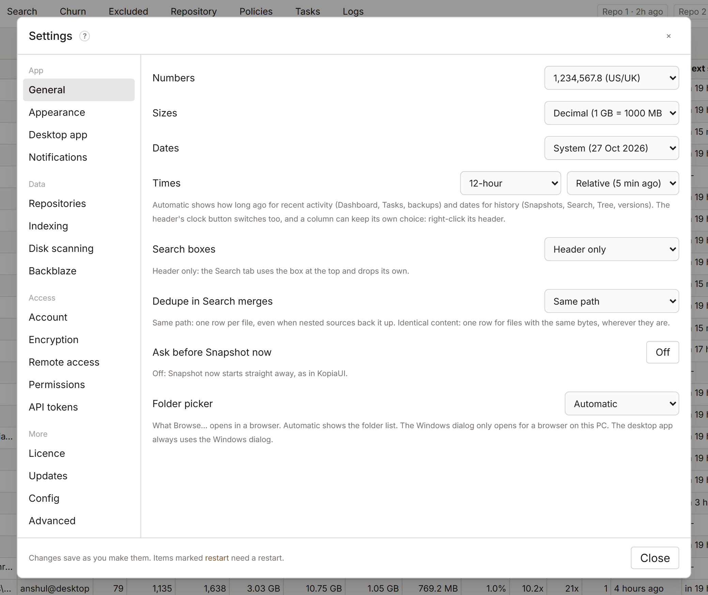

# Settings

Settings holds everything you can change in KopiaLens. Open it with the gear button at the top right. Changes save as you make them. A few are marked **restart**: they apply after you quit and reopen KopiaLens.

Each section has a **?** button that opens its help. Some sections have their own page:

| Section | Page |
|---|---|
| Notifications | [Notifications](notifications.md) |
| Repositories | [Repositories](repositories.md) |
| Account | [Sign-in and your account](sign-in.md) |
| Encryption | [Encryption](encryption.md) |
| Remote access | [Remote access and HTTPS](remote-access.md) |
| API tokens | [API tokens](api-tokens.md) |
| Licence | [Free and Pro](licensing.md) |
| Updates | [Update checks and usage stats](usage-stats.md) |

The other sections are described below.

## General

| Setting | What it does |
|---|---|
| **Numbers** | How numbers are written, for example `1,234,567.8` or `1.234.567,8`. **System** follows your computer |
| **Sizes** | **Decimal** (1 GB = 1000 MB, as kopia shows them) or **Binary** (1 GiB = 1024 MiB) |
| **Dates**, **Times** | How dates and clock times are written. **Exact** shows the time, **Relative** shows how long ago. The clock button in the header switches between them too |
| **Search boxes** | **Header and Search tab**, or **Header only**: the Search tab then uses the box at the top of the window |
| **Dedupe in Search merges** | What **Dedupe** in Search merges: **Same path** or **Identical content** ([Search](search.md#filters)) |
| **Ask before Snapshot now** | On by default. Off: **Snapshot now** starts straight away, as in KopiaUI |
| **Folder picker** | What **Browse…** opens in a browser: the KopiaLens folder list, or the Windows dialog (only for a browser on the computer running KopiaLens). The desktop app always uses the Windows dialog |
| **Snapshot mount folder** | On Linux and macOS, mounted snapshots appear in folders inside this one |
| **Mount folder on the host** | In Docker: the host folder mapped to the container's mount folder, so mount paths show as you see them on the host |

## Appearance

| Setting | What it does |
|---|---|
| **Theme** | A light and a dark theme. **System** follows your computer's light or dark setting. Saved on the server, so it follows you between browsers |
| **Density** | Row height and text size. **Custom** shows a slider in 1% steps |
| **Table alignment** | How table columns line up unless a table or column has its own choice ([Tables](tables.md#table-layout)). **Auto**, the default, puts numbers on the right and text on the left |
| **Tab order** | **Reset to default** puts the tabs back in their first order. To move a tab, drag it in the tab row |
| **Font** | The font for the whole app |
| **Sort arrows in table headers** | **Sorted column only** or **Every column** |
| **Detail panel layout** | **Classic** shows every section of the file and folder panels in one scroll. **Tabbed** keeps the summary on screen and groups the rest |
| **Documentation opens as** | **A popup** or **A side panel** |
| **Policy editor layout** | **Tabs** (one section at a time) or **Scroll** (every section stacked) |
| **Leaving a policy with unsaved changes** | **Ask first**, or **Keep the changes as a draft** |
| **Repo labels** | **Short** (Repo 1, Repo 2, BZ) or **Full** (the repository's name) in chips, headers and log columns |
| **Logo** | The mark next to the KopiaLens name |
| **Retention chips** | The colours of retention reasons in the Snapshots tab: **One colour**, **By type, like KopiaUI**, or **Custom colour** |
| **Pro badge** | The small Pro mark next to the KopiaLens name while a licence is active |

**Logo** picks the mark next to the KopiaLens name in the header and on the browser tab: Disc (the default), K, Ring or Tile. None hides it.

## Desktop app

These apply to the KopiaLens desktop app and its tray icon.

| Setting | What it does |
|---|---|
| **Clicking the tray icon** | **Opens KopiaLens** or **Shows the menu**. Right-clicking always shows the menu |
| **Double-clicking the tray icon** | **Opens KopiaLens** or **Does nothing** |
| **Tray icon** | The icon in the system tray |

**Tray icon** picks the icon KopiaLens shows in the system tray. Disc is the default. K and Ring switch between their light and dark versions to suit the taskbar.

**Desktop shortcut icon.** The installer gives the shortcut the Disc. To use another logo, right-click the shortcut, choose **Properties → Change Icon**, and pick a file from the `icons` folder inside the KopiaLens folder: `KopiaLens Disc.ico`, `KopiaLens K.ico`, `KopiaLens Ring.ico` or `KopiaLens Tile.ico`.

## Indexing

| Setting | Default | What it does |
|---|---|---|
| **Kopia indexing** | Once a day at 23:00 | When the index updates: **Once a day, at a set time**, **Every N hours**, or **Off, only when I start it** ([Indexing](indexing.md#when-the-index-updates)) |
| **Pause indexing** | | Stops automatic index runs for a while |
| **Dashboard numbers** | Rebuild with nightly indexing | Or **Also rebuild during the day**. The Dashboard's refresh button rebuilds them at any time |
| **Full rebuild** | | **Rebuild full index** reads every snapshot again. Rarely needed, and much slower |
| **Index backups** | | Older versions of the index and a copy in another folder ([Index backups](indexing.md#index-backups)) |
| **Quick refresh** | 30 minutes | How often next snapshot times, repository details and the Search start page are brought up to date |
| **Dashboard auto-refresh** | 15 minutes | How often an open Dashboard checks for new numbers |
| **Dashboard rebuild interval** | 4 hours | With **Also rebuild during the day**: how often the size columns are rebuilt |

## Disk scanning

How KopiaLens reads your disks for the Excluded tab and rule previews, and the network shares and other places it checks. Every setting is on its own page: [Disk scanning](disk-scanning.md#settings).

## Backblaze

| Setting | What it does |
|---|---|
| **Add Backblaze** | Adds the Backblaze view when Backblaze Personal Backup is on this computer ([Backblaze](backblaze.md)) |
| **Backblaze updates** | **When Backblaze's file lists change**, or **Off, only when I start it**. Separate from kopia indexing |
| **Backblaze data folder** | Where the Backblaze client keeps its file lists. Empty finds it on its own. KopiaLens never writes there |
| **File index format** | **Parquet** (the default, smaller and faster) or **SQLite** (the older format). Switching rebuilds it at the next Backblaze update |
| **Reindex minimum gap** | How long to wait after Backblaze's own scan changes before reading it again |
| **History retention** | How many days of folder history to keep for the trends |
| **Collapse prefixes** | Paths that show as one row in the Queue, Churn and folder views, instead of one row per subfolder |
| **Session history folder** | A readable copy of Backblaze's older event logs, for **Import archived history** in the Sessions tab |

## Permissions

Permissions set what KopiaLens may change in a repository. They apply to you, to scripts and to AI agents alike.

| Level | What it allows |
|---|---|
| **Read-only** | Browse, search, mount and download |
| **Restores allowed** | Also restore to disk |
| **Non-destructive** | Also take snapshots, pin, change policies and descriptions, and run maintenance |
| **Full Access** | Also delete files, snapshots and sources. The default |

Set the level for **All repositories**, then change it for single repositories under **Per repository** if needed. The **?** beside **All repositories** opens this section. **Read-only** and **Restores allowed** also stop KopiaLens's scheduled backups for that repository.

When a KopiaLens password is set, raising a level to **Full Access** asks for it. Below **Full Access**, the repository picker in the header shows a small eye (**Read-only**) or lock icon. Its tooltip and the repository menu name the level, and **Permissions:** in that menu changes it. Actions the level doesn't allow are greyed out.

[API tokens](api-tokens.md#permissions) have their own permission on top. A token can never do more than the repository's level allows.

## Config

**Backups of these settings** keeps copies of your KopiaLens settings, repository list, sign-in accounts and encryption key files. KopiaLens makes a copy before changes, once a week and before upgrades. Your kopia backups aren't part of it.

- **Back up now** makes a copy now.
- **Restore…** on a copy lists every change before anything is replaced: each setting as it is now and in the copy, repositories added, removed or changed, table layouts, accounts and keys.

Some changes affect who can get in or what KopiaLens may change: sign-in and remote access, permissions, who runs backups, accounts and keys. They start with **Keep current** ticked, so the restore leaves them as they are now. Untick **Keep current** to restore them too.

**Export to a file** saves your settings and repository list as one file, to move KopiaLens to another computer or to keep a copy elsewhere. Tick **Include sign-in accounts** or **Include encryption key files** to add them. The file then holds password hashes or your locked encryption key, so keep it somewhere private.

**Import from a file** reads an exported file. You see the same list of changes, with **Keep current**, before anything is replaced.

## Advanced

These have sensible defaults. Change them when you have a reason.

### Indexing

| Setting | Default | What it does |
|---|---|---|
| **Memory limit** | Automatic | The most memory each repository's index may use, in the app and while indexing. Automatic is based on the computer's memory (restart) |
| **Indexing time limit** | 4 hours | A run that takes longer is stopped. The next run continues where it left off |
| **First index time limit** | 24 hours | The same for a first index |
| **Give up on an unreachable repository after** | 30 minutes | The run stops, keeps its progress, and the next repository can index |
| **Stop an index that makes no progress after** | 60 minutes | 0 turns it off |
| **Update the index after deletes** | 5 minutes | How long after the last delete |
| **Most files in one delete plan** | 200000 | A bigger match is planned for its biggest files first |
| **Retry after a failed run** | 15 minutes | How long to wait before trying again |
| **Retries per scheduled slot** | 1 | 0 means a failed run waits for the next scheduled one |
| **When quitting KopiaLens** | Let indexing finish | Or **Stop indexing**. **Restart** always lets indexing finish |
| **Folder reclaimable space ahead of time** | 15 minutes | How long each night's run spends working out folder sizes ahead of time, biggest folders first. Other folders are worked out when you open them. 0 turns it off |
| **Quiet period after startup** | 5 minutes | How long after KopiaLens starts before background work begins (restart) |
| **Gap between background runs** | | With **Every N hours**: the least time between two runs |
| **Ranked files** | 10000 | How many of the biggest files are ranked exactly for Search's sorting |
| **Listing backend** | Run kopia when needed | How KopiaLens asks kopia for snapshot lists. **Keep a kopia server running** is the other choice (restart) |

### App

| Setting | Default | What it does |
|---|---|---|
| **Debug log** | Off | Writes detailed diagnostics beside the normal app log. Turn it on only to find a problem |
| **Experimental features** | Off | Shows the [Experimental](#experimental) section |
| **Local control port** | Off | Lets scripts and AI tools on the computer running KopiaLens check, restart or quit it through the desktop app. Web pages can't use it (restart) |
| **Ports** | 7123 and 7124 | The app's port and the control port. Change them if another program uses them, or to run a second KopiaLens. A bookmark or reverse proxy then needs the new port (restart) |
| **Log cleanup** | 90 days | How long job, dry-run and mount logs are kept. The newest 100 are always kept |
| **Task history** | 90 days | How long finished backups and maintenance stay in the Tasks tab |
| **When another app stops running backups** | KopiaLens takes over again | Or **Wait for me to resume** ([Who runs backups](backups.md#who-runs-backups)) |

## Experimental

Shown when **Experimental features** is on (Advanced). These features are still being built and may change or go away. Reload the page after turning one on or off.

| Setting | Default | What it does |
|---|---|---|
| **Notes** | Off | Adds a Notes button to every page, for writing notes about what you see, with a screenshot. Notes are kept in the `notes` folder inside KopiaLens's data folder |

## About

About shows the KopiaLens and kopia versions, whether KopiaLens runs as the desktop app or a server, where its data folder is, the data format version and the system it runs on.

- **Check now** checks for a newer version ([Getting help](getting-help.md#updates)).
- **Copy details** copies these facts for a bug report.
- **Create diagnostics bundle…** collects logs and details into one file ([Getting help](getting-help.md#diagnostics-bundle)).
