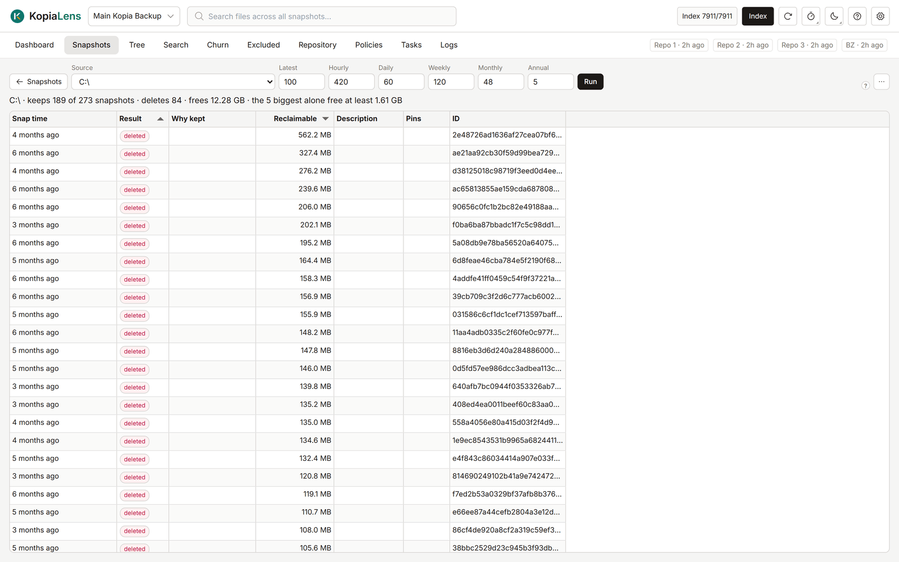

# Simulate

Simulate shows what a [retention](glossary.md#retention) policy would keep and how much space deleting the rest frees, before you change anything. Nothing in the repository changes here.

## Try a retention policy

1. Open **Snapshots** and select **Simulate retention…**. Simulate shares its source with the Snapshots tab: **All sources** or one source.
2. Enter how many snapshots to keep in the boxes: **Latest**, **Hourly**, **Daily**, **Weekly**, **Monthly** and **Annual**.
3. Select **Run**.

The first time, the boxes show the repository's Global policy, or kopia's own defaults where the Global policy sets nothing. After that, Simulate remembers the last policy you tried on each repository.

Pinned snapshots are always kept, whatever the policy says.

## What it shows

| Column | What it means |
|---|---|
| **Source** | The folder kopia backs up |
| **Total** | Snapshots of this source today |
| **Keep** | Snapshots the policy would keep |
| **Delete** | Snapshots it would delete |
| **Reclaimable** | The space deleting them gives back |
| **Pins** | Pinned snapshots, which are kept anyway (only with **All sources**) |

With **All sources**, the line above the table gives the total. The total is often more than one source's figure suggests and less than all the figures added up:

- A source's **Reclaimable** counts only what that source alone gives back.
- Data that two sources share comes back only when both delete it, so it appears only in the total. The line says how much is shared.

To open a source's snapshots, double-click its row.

### One source

With one source, the line above the table sums up the result: how many snapshots it keeps and deletes, and the space that frees. The table lists every snapshot:

| Column | What it means |
|---|---|
| **Start** | When the snapshot was taken |
| **Result** | **kept** or **deleted** |
| **Why kept** | kopia's reasons for keeping it, such as `latest-1` or `daily-3` |
| **Reclaimable** | The space deleting only this snapshot gives back. It fills in when KopiaLens has worked it out |
| **Description** | The snapshot's description |
| **Pins** | Its [pins](glossary.md#pin) |

Snapshots that would be deleted come first, the biggest saving first.

## Saved results

With **All sources**, KopiaLens saves the result and shows it again next time, with the time it was worked out. To work it out again from the current index, select **Recompute (ignore the saved result)** in the **…** menu. **Export CSV** is in the same menu.

## How exact it is

KopiaLens works out which snapshots a policy keeps with its own copy of kopia's retention rules. Every index run checks that copy against what kopia itself reports for each source. The space figures come from the last [index run](glossary.md#index-run).

Simulate doesn't change the policy. To change it, open the source's policy in the [Policies](policies.md) tab. The policy editor shows what the new retention keeps before you save.

## Related

- [Snapshots](snapshots.md)
- [Policy editor](policy-editor.md#retention)
- [How KopiaLens counts space](space.md)
