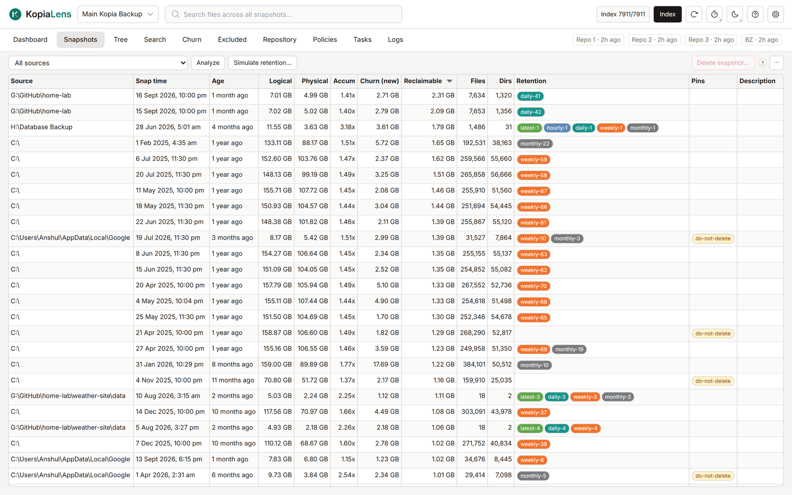

# Snapshots

The Snapshots tab lists the [snapshots](glossary.md#snapshot) of one source, or of every source, with the new data each one added and the space deleting it gives back. Use it to pin, compare, restore and delete snapshots.

## What it shows

Pick **All sources** or one source in the list at the top left. KopiaLens remembers the choice per repository. The [Simulate](simulate.md) tab uses the same source.

| Column | What it means |
|---|---|
| **Source** | The folder the snapshot is of (only with **All sources**) |
| **Start** | When the snapshot started |
| **Description** | The snapshot's description, if it has one |
| **Logical** | The snapshot's size, as on disk |
| **Physical** | The space this snapshot takes in the repository |
| **Accum** | Logical divided by Physical: how much compression and deduplication save on this snapshot. 3.0x means it takes a third of its size |
| **Churn (new)** | The data this snapshot added that no earlier snapshot had ([churn](glossary.md#churn)) |
| **Reclaimable** | The space that deleting this snapshot alone gives back |
| **Files**, **Dirs** | How many files and folders the snapshot holds |
| **Retention** | Why kopia keeps this snapshot: `latest-1`, `daily-3` and so on. Empty means no retention rule keeps it |
| **Pins** | The snapshot's [pins](glossary.md#pin) |
| **ID** | kopia's snapshot ID |

Reclaimable counts each snapshot on its own. Deleting two snapshots often frees more than their two numbers added up, because data they share comes back only when both go. The delete panel works out the real total for the snapshots you select.

## Churn and Reclaimable need Analyze

The **Churn (new)** and **Reclaimable** columns stay empty until they are worked out.

- With one source selected, select **Analyze** to work them out for that source.
- With **All sources** selected, **Analyze** works them out for every source. The list is then sorted by Reclaimable, so the snapshots that free the most come first.

**Numbers from the last run** means the figures belong to the previous index run. Select **Analyze** to bring them up to date.

For a repository reached through a kopia server, the space columns don't show: KopiaLens has no index for it ([Browse-only](glossary.md#browse-only)).

## Select snapshots

Click a row to select it. Hold Ctrl or Shift to select several. Right-click opens a menu for the selection. To select a common set in one step:

- **Select unretained snapshots** selects every snapshot that no retention rule and no pin keeps. Kopia deletes these on its own the next time it takes a snapshot of that source, because it applies retention after every snapshot.
- **Select identical duplicates** finds snapshots with exactly the same content. In each set it keeps the oldest and the newest and selects the ones in between. Pinned snapshots are never selected.

## What you can do

| Action | How |
|---|---|
| Browse a snapshot's folders | Double-click it, or right-click it and select **Show in Tree** |
| Restore a whole snapshot | Right-click it and select **Restore this snapshot…** ([Restore](restore.md)) |
| Mount a snapshot | Right-click it and select **Mount** ([Mount](restore.md#mount)) |
| Change the description | Right-click it and select **Edit description…** |
| Compare two snapshots | Select two, right-click and select **Compare 2 snapshots**. KopiaLens shows kopia's list of what changed |
| Pin or unpin | Select one or more, right-click and select **Pin…** or **Unpin**. The default pin name is `do-not-delete`. **Rename pin…** renames it on every selected snapshot |
| Delete | Select one or more and select **Delete snapshot…** at the top right ([Deleting snapshots and sources](delete-snapshots.md)) |
| Try a retention policy | Select **Simulate retention…** ([Simulate](simulate.md)) |
| Copy IDs | Right-click and select **Copy snapshot ID** |

Kopia saves a pinned or re-described snapshot under a new ID. KopiaLens reloads the list afterwards.

The colours of the retention chips are set in **Settings → Appearance → Retention chips**.

## Related

- [How KopiaLens counts space](space.md)
- [Simulate](simulate.md)
- [Deleting snapshots and sources](delete-snapshots.md)
