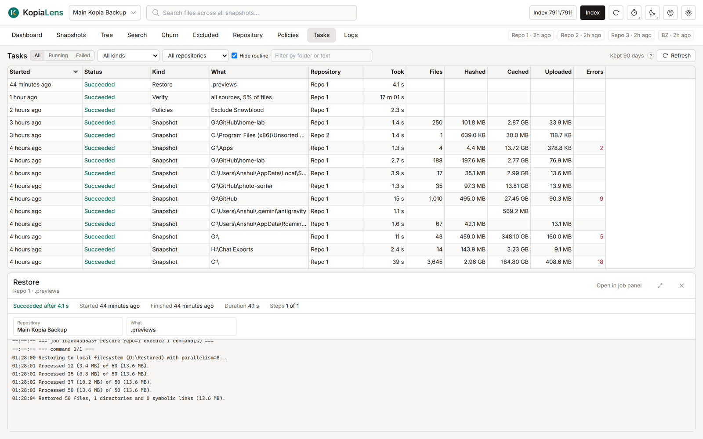

# Tasks

The Tasks tab lists every backup, maintenance run and KopiaLens job, running and finished, across all repositories. Open a task to see its progress and kopia's log, or to stop it.

## What it shows

| Column | What it means |
|---|---|
| **Started** | When the task started |
| **Status** | **Running**, **Succeeded**, **Finished with errors**, **Failed** or **Canceled** |
| **Kind** | What sort of task it is: Snapshot, Maintenance, Remove files, Prune versions, Restore, Verify and so on |
| **What** | The folder or the action it worked on. A dry run says **(dry run)** |
| **Repository** | The repository it ran on |
| **Took** | How long it ran, or has run so far |

Backups and maintenance appear here when KopiaLens runs a repository's backups ([Who runs backups](backups.md#who-runs-backups)). Jobs you start in KopiaLens, such as deletes, restores and dry runs, appear for every repository. While a task runs, the Tasks tab shows the count, for example **Tasks (1)**.

The list updates every few seconds while the tab is open.

## Filter the list

- **All**, **Running** or **Failed**. Failed also lists tasks that finished with errors.
- A kind and a repository, in the two lists.
- **Filter by folder or text** matches the task's description and its error.

## Open a task

Click a row. The task opens with its start and finish times, how long it took, its counters and kopia's log as it runs.

- **Counters** list what kopia counted, such as files, folders, hashed and cached files, excluded files and errors. Counters at zero are greyed.
- **Output** shows kopia's messages, each with its details in grey. KopiaLens saves them while the task runs, so long tasks keep every line.
- **Full log** shows kopia's complete log for jobs KopiaLens runs on the command line.

- **Stop** stops a running task.
- **Open in job panel** opens a KopiaLens job in the [job panel](job-panel.md).
- The button beside them switches between a full-size popup and a small panel under the list. KopiaLens remembers the choice.

## How long tasks are kept

Finished backups and maintenance are kept for 90 days by default. The number next to the filters shows the current setting. Change it in **Settings → Advanced → Task history**.

## Related

- [Backups](backups.md)
- [Job panel](job-panel.md)
- [Logs](logs.md)
