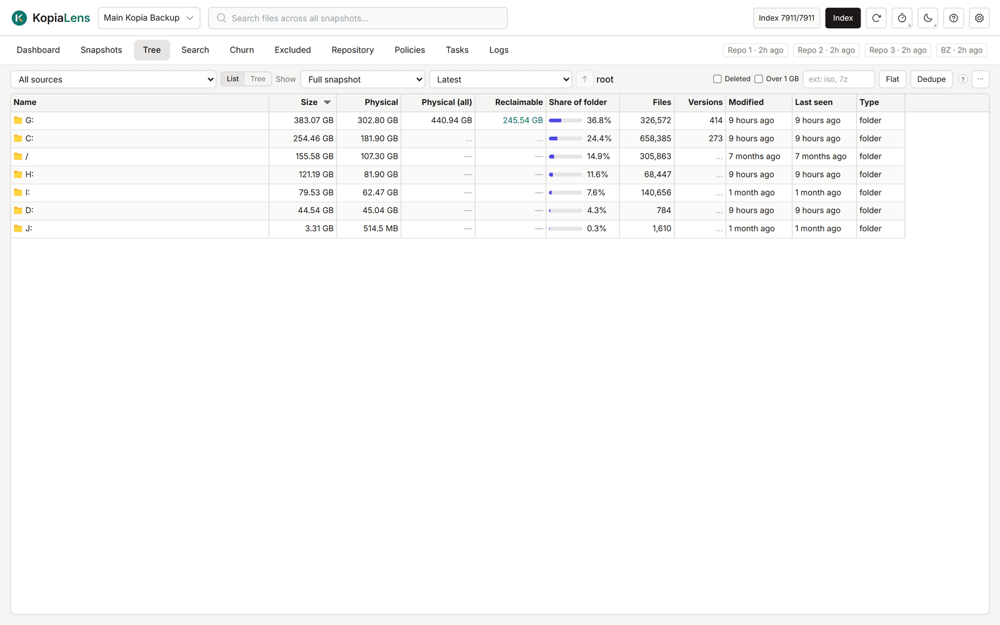

# Tree

The Tree shows the folders and files in your backups by size, like a disk-space tool for snapshots. Use it to find what takes the most space and to act on it.

## Choose what to look at

The bar at the top sets what the Tree lists.

1. **Source:** **All sources** or one source. The Tree remembers its own choice per repository.
2. **Show:**
   - **Full snapshot**: everything in one snapshot, as it was then. With **All sources**, the latest snapshot of each source.
   - **Changed in this snapshot**: only what changed since the snapshot before it.
   - **Reclaimable if deleted**: the files whose space deleting this snapshot gives back, biggest first. With **All sources**, it lists only snapshots already worked out with **Analyze** in the [Snapshots](snapshots.md) tab.
   - **All snapshots**: every file that any snapshot holds, including files since deleted from disk.
3. **Snapshot:** with one source, pick the snapshot. With **All sources**, pick **Latest** or a week. A week lists what each source backed up that week. Files that didn't change that week aren't listed.

## Views

- **List** shows one folder at a time. Double-click a folder to open it. **↑** goes up one level.
- **Tree** opens folders in place with the arrow beside each name.

## What it shows

| Column | What it means |
|---|---|
| **Name** | The file or folder |
| **Size** | Its size, as on disk ([logical](glossary.md#logical)) |
| **Physical** | The space its newest version takes in the repository |
| **Physical (all)** | The space every version takes together. Worked out for the rows on screen |
| **Reclaimable** | The space that removing it from the backups gives back. Worked out for the rows on screen |
| **Share of folder** | Its share of the folder's size, as a bar |
| **Files** | Files inside it |
| **Versions** | For a file, how many versions are backed up. For a folder, how many different states it has had |
| **Modified** | When it last changed on disk |
| **Last seen** | When a snapshot last held it |

Right-click a column header to show **Ext**, **Src** (how many sources hold the file) and **Type**.

## Filters

| Filter | What it does |
|---|---|
| **Deleted** | Only folders that hold files deleted from disk. Works with **All snapshots** or **All sources** |
| **Over 1 GB** | Only files of 1 GB or more |
| Extensions box | Only these extensions, for example `iso, 7z` |
| **Flat** | Every file under the folder in one list, without folders. Works in List view |
| **Dedupe** | Files with identical content once |

## What you can do

Right-click a row:

- **Open** a folder, or see its **Details** ([Folder panel](folder-panel.md) or [File panel](file-panel.md)).
- **Show in Search** lists the folder's files, or files with that name, in [Search](search.md).
- **Restore…**, **Download** or **Mount** ([Restore, download and mount](restore.md)).
- **Exclude…** keeps it out of future snapshots ([Exclude](exclude.md)).
- **Prune versions…** removes old versions and keeps the ones you choose ([Prune versions](prune.md)).
- **Delete from backups…** or **Delete folder from backups…** removes it from existing snapshots ([Delete from backups](delete-files.md)).
- **Exclude & delete…** does both: no future snapshots and none of the old ones.
- **Copy path**.

To act on several rows, select them with Ctrl or Shift and right-click.

The **…** menu has **Mount this snapshot** (read-only, opens the folder you're in) and **Export CSV**.

## Related

- [Search](search.md)
- [How KopiaLens counts space](space.md)
- [Find what's using the most space](guide-find-space.md)
